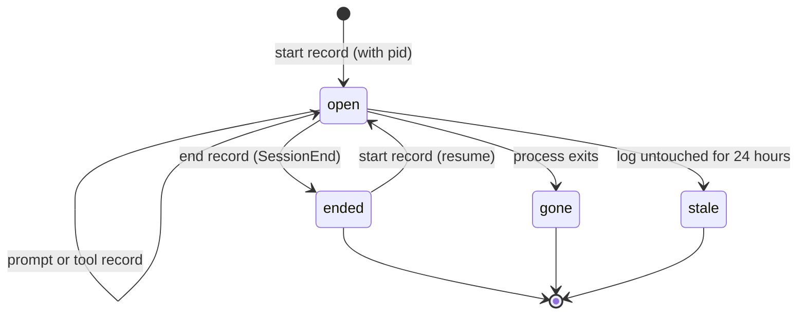

# F-001: Contract

## Data structures

```ts
// src/core/live.ts: `pid` is Claude Code's process ID (CLAUDE_PID), when the hook had one.
export type LiveRecord =
  | { kind: "start"; at: string; source?: string; pid?: number }
  | { kind: "prompt"; at: string; pid?: number }
  | /* tool, session, stop, end, cursor: unchanged */;

/** What deciding whether a session is open needs from the outside world. */
export interface OpenCheck {
  now: Date;
  /** How long a session without a process ID counts as open after its last record. */
  idleMs: number;
  /** Whether a process is running (injected so tests don't depend on real processes). */
  alive: (pid: number) => boolean;
}

// src/hooks/handlers.ts
export interface HookEnv {
  /* existing keys */
  CLAUDE_PID?: string;
}
export interface HookContext {
  /* existing keys */
  /** Starts the viewer if needed and returns its URL; waitMs 0 doesn't wait for a new one. */
  ensureViewer?: (root: string, waitMs?: number) => Promise<string | null>;
}

// src/server/server.ts
export interface ServerOptions {
  /* existing keys */
  /** Process check for open sessions; defaults to signalling the process with 0. */
  alive?: (pid: number) => boolean;
}
```

## Public signatures

```ts
// src/core/live.ts
/** Whether one Claude Code session's live log describes a session that is still open. */
export function sessionOpen(records: LiveRecord[], check: OpenCheck): boolean;
/** Whether any Claude Code session of this project is open (logs written in the last 24 hours). */
export function anySessionOpen(root: string, check: OpenCheck): boolean;
/** Whether a process with this ID is running (EPERM counts as running). */
export function processAlive(pid: number): boolean;

// src/hooks/handlers.ts
export function userPromptSubmit(input: HookInput, ctx: HookContext): Promise<HookOutput>;
```

## Errors

None new. `processAlive` returns false for an unknown process; a hook that can't start the viewer
returns as before without blocking the prompt.

## State transitions


