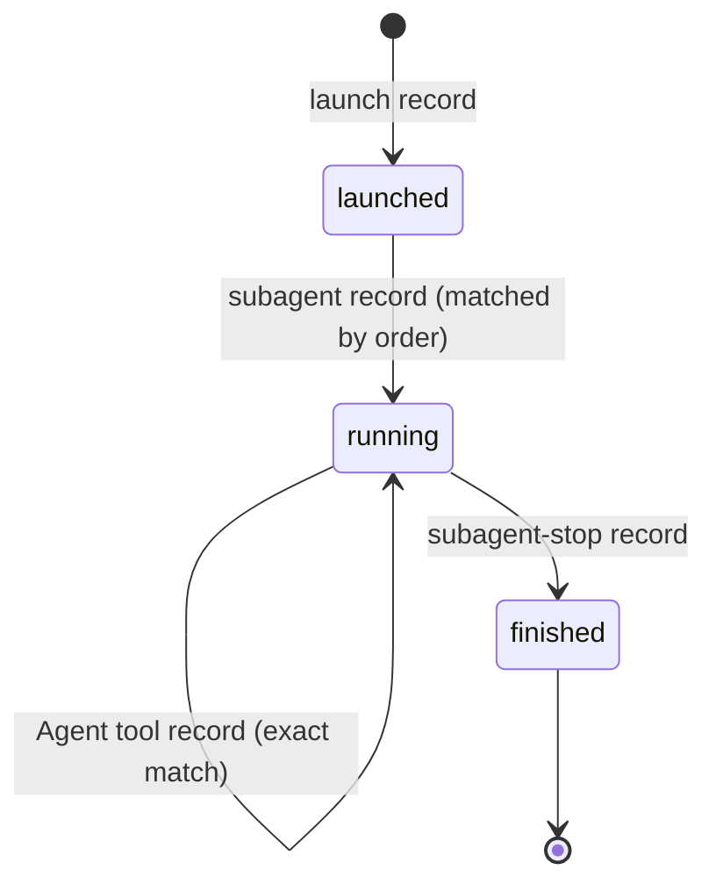

# F-005: Contract

## Data structures

```ts
// src/core/live.ts: new live records (the log stays append-only JSONL).
export type LiveRecord =
  | /* start, session, prompt, stop, end, cursor: unchanged */
  | {
      kind: "tool";
      at: string;
      tool: string;
      file: string | null;
      summary: string;
      agent_id?: string | null;
      agent_type?: string | null;
      /** The Agent tool's own tool use, and the subagent it started (from its response). */
      tool_use_id?: string | null;
      spawned?: string | null;
    }
  /** PreToolUse for the Agent tool: what a subagent is being asked to do. */
  | { kind: "launch"; at: string; tool_use_id: string; description: string; refs: string[] }
  /** SubagentStart and SubagentStop. */
  | { kind: "subagent"; at: string; agent_id: string; agent_type: string | null }
  | { kind: "subagent-stop"; at: string; agent_id: string };

// src/core/types.ts (index contract)
export interface LiveAgent {
  agent_id: string;
  agent_type: string | null;
  last_seen_at: ISODateTime;
  /** What the orchestrator asked for (the Agent tool's description), when known. */
  description: string | null;
  task: Id | null;
  feature: Id | null;
  /** Set once the subagent has finished. */
  stopped_at: ISODateTime | null;
}

export interface LiveSession {
  /* existing fields unchanged, except: */
  agents: LiveAgent[];
  /** Features the main agent or a running subagent is working on, sorted by ID. */
  features: Id[];
}

// src/hooks/handlers.ts
export interface HookInput {
  /* existing keys */
  tool_use_id?: string;
  tool_response?: unknown;
}
```

## Public signatures

```ts
// src/hooks/handlers.ts (registered in HOOKS as "pre-tool-use", "subagent-start", "subagent-stop")
export function preToolUse(input: HookInput, ctx: HookContext): HookOutput;
export function subagentStart(input: HookInput, ctx: HookContext): HookOutput;
export function subagentStop(input: HookInput, ctx: HookContext): HookOutput;

// src/core/live.ts
/** Task and feature IDs a launch names: its description's, or its prompt's when it names none. */
export function launchRefs(description: string, prompt: string): string[];
```

## Errors

None new. Every new hook exits 0 with no output, also on malformed input, outside an Azimuth
project, or for tools other than Agent/Task.

## State transitions


