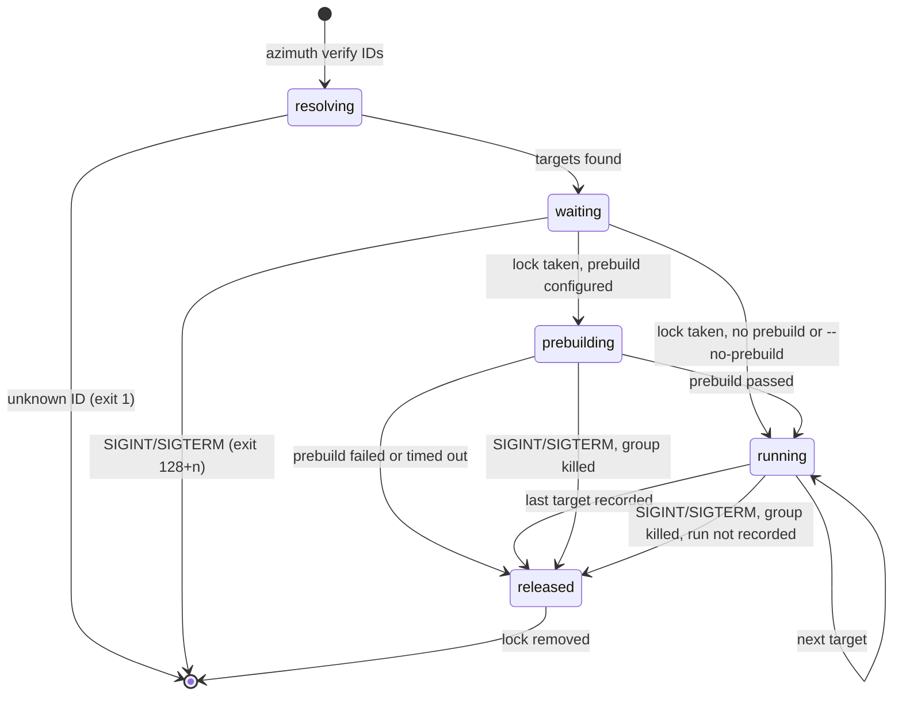

# F-007: Contract

## Data structures

```ts
// src/core/config.ts: two new keys in the verify section (other sections unchanged).
export interface Config {
  /* … */
  verify: {
    timeout_seconds: number; // per target command, as today
    output_tail_lines: number;
    /** Run once per `azimuth verify` call before the targets; null (or blank) = no prebuild. */
    prebuild: string | null;
    /** Timeout of the prebuild alone. */
    build_timeout_seconds: number;
  };
}
// DEFAULT_CONFIG.verify = { timeout_seconds: 600, output_tail_lines: 40, prebuild: null, build_timeout_seconds: 1800 }
// SHAPE.verify adds  prebuild: r.nullable(r.string()), build_timeout_seconds: r.int(1)

// src/core/types.ts: optional, so runs written before this feature stay valid and unchanged.
export interface VerifyRun {
  /* id, target, command, ok, exit_code, duration_ms, at, commit, output_tail, scenarios, junit: unchanged */
  /** How long the call waited for another verify's lock before it started; 0 when it didn't. */
  waited_ms?: number;
  /** The Azimuth session current when the run was made; null outside a session. */
  ses?: Id | null;
}
// parseRun keeps waited_ms only when it is a number ≥ 0, and ses only when it is a session ID or
// null; otherwise the key is left out (no problem is reported).

// src/core/shell.ts (new)
export interface ShellOptions {
  cwd: string;
  env: NodeJS.ProcessEnv;
  timeoutMs: number;
  /** Between SIGTERM and SIGKILL to the process group; default KILL_GRACE_MS. */
  graceMs?: number;
  /** Aborting kills the process group like a timeout does. */
  signal?: AbortSignal;
}

export interface ShellResult {
  /** The command's exit code; 124 after a timeout; 1 when a signal ended it otherwise. */
  exit_code: number;
  /** stdout followed by stderr, the last 64 MB of each. */
  output: string;
  timed_out: boolean;
  aborted: boolean;
  duration_ms: number;
}

export const KILL_GRACE_MS = 2_000;

// src/core/lock.ts
export interface VerifyLockOptions {
  /** Injected for tests; default Date.now. */
  now?: () => number;
  /** Injected for tests; default a 250 ms timer. */
  sleep?: (ms: number) => Promise<void>;
  /** Aborting while waiting gives up (the lock is left to its holder). */
  signal?: AbortSignal;
}

export interface VerifyLock {
  waited_ms: number;
  /** Removes verify.lock; safe to call twice. */
  release(): void;
}
// verify.lock lives in sharedCacheDir(root) and holds JSON { pid, at } like write.lock.

// src/core/verify.ts
export interface VerifyTarget {
  task: string;
  feature: string;
  command: string;
  covers: string[];
}

export interface RunContext {
  waited_ms: number;
  ses: Id | null;
  signal?: AbortSignal;
  now?: () => Date;
}

export interface PrebuildResult {
  command: string;
  ok: boolean;
  /** 124 after a timeout. */
  exit_code: number;
  duration_ms: number;
  /** Last verify.output_tail_lines lines; ends with "[azimuth] prebuild timed out after <N>s" on a timeout. */
  output_tail: string;
}

/** What verifyBatch reports as it goes, in this order. */
export type VerifyProgress =
  | { kind: "waited"; waited_ms: number } // once, after the lock is taken
  | { kind: "prebuild"; command: string } // before the prebuild starts
  | { kind: "prebuilt"; result: PrebuildResult } // after it ends
  | { kind: "target"; target: VerifyTarget } // before each target's command starts
  | { kind: "run"; run: VerifyRun }; // after each run is recorded

export interface VerifyBatchOptions {
  /** Run verify.prebuild first when one is configured; default true (`--no-prebuild` passes false). */
  prebuild?: boolean;
  /** Written to every run as `ses`; default null. */
  ses?: Id | null;
  onProgress?: (event: VerifyProgress) => void;
  /** Aborting kills the running command's group; it and the remaining targets aren't recorded. */
  signal?: AbortSignal;
  /** Injected for tests. */
  lock?: Pick<VerifyLockOptions, "now" | "sleep">;
  now?: () => Date;
}

export interface VerifyBatchResult {
  waited_ms: number;
  /** null when no prebuild is configured or it was skipped. */
  prebuild: PrebuildResult | null;
  /** In target order; [] when the prebuild failed. */
  runs: VerifyRun[];
  interrupted: boolean;
}

// src/cli/verify-report.ts (new)
export type ReportMode = "full" | "summary";
```

## Public signatures

```ts
// src/core/shell.ts
/** Runs `/bin/sh -c command` detached; on timeout or abort sends SIGTERM to -pid, then SIGKILL after graceMs. */
export function runShell(command: string, options: ShellOptions): Promise<ShellResult>;

// src/core/lock.ts
/**
 * Takes verify.lock, waiting (never failing busy) while a live process holds it. A lock whose pid
 * is dead, or an unparseable one older than 30 s, is taken over; age alone never is.
 * Resolves null when options.signal aborts while waiting.
 */
export function acquireVerifyLock(root: string, options?: VerifyLockOptions): Promise<VerifyLock | null>;

// src/core/verify.ts
/**
 * Tasks to verify for several task and feature IDs, deduplicated in the order named; with no IDs,
 * every task of in-progress and verifying features. Throws before anything runs.
 */
export function verifyTargets(root: string, ids: string[]): VerifyTarget[]; // was (root, id: string | null)

/** Runs one target's verify command and records the run; null when aborted (nothing recorded). */
export function runVerify(root: string, target: VerifyTarget, context: RunContext): Promise<VerifyRun | null>; // was sync

/**
 * Takes the verify lock, runs verify.prebuild once (unless skipped), then each target in order,
 * and releases the lock. No targets: returns at once without waiting or building.
 */
export function verifyBatch(
  root: string,
  targets: VerifyTarget[],
  options?: VerifyBatchOptions,
): Promise<VerifyBatchResult>;

// src/cli/verify-report.ts
/** The lines `azimuth verify` prints for one progress event (coloured only on a TTY). */
export function reportLines(event: VerifyProgress, mode: ReportMode): string[];
```

### CLI

```text
azimuth verify [T-ID | F-ID …] [--no-prebuild] [--summary] [--json]
```

| Event            | full                                            | summary |
| ---------------- | ----------------------------------------------- | ------- |
| waited (> 0)     | `waited 40s for another verify`                 | same    |
| waited (0)       | nothing                                         | same    |
| prebuild         | `prebuild: <command>` (dim)                     | nothing |
| prebuilt, passed | `prebuild passed in 41.2s`                      | nothing |
| prebuilt, failed | `prebuild failed (exit 2) in 3.1s` + tail       | same    |
| target           | `T-005.4: <command>` (dim)                      | nothing |
| run, passed      | `R-0142 T-005.4 passed in 1.2s`                 | same    |
| run, failed      | `R-0142 T-005.4 failed (exit 1) in 2.1s` + tail | same    |

A tail is the run's (or prebuild's) `output_tail`, each line indented four spaces and dimmed, and
is printed only when not empty. Seconds in "waited" round up to whole seconds; durations keep one
decimal, as today. With `--json`, stdout is only the JSON array of runs (`[]` after a failed
prebuild, whose lines go to stderr).

Exit codes: 0 when every run passed (or nothing ran); 1 when a run or the prebuild failed, or an
ID is unknown or has no verify command; 128 + signal number (130, 143) after SIGINT or SIGTERM.

## Errors

| Case                                       | Result                                                                                              |
| ------------------------------------------ | --------------------------------------------------------------------------------------------------- |
| Unknown ID among several                   | `AzimuthError("not-found", "<ID> is not a feature or task in this project.")`, exit 1, nothing runs |
| ID with no verify command                  | `AzimuthError("invalid", "<ID> has no verify command to run.")`, exit 1, nothing runs (unchanged)   |
| Prebuild exits non-zero or times out       | Nothing thrown: `result.prebuild.ok` false, `runs` `[]`, exit 1                                     |
| verify.lock held by a live process         | Nothing thrown: waits, then `waited_ms` > 0                                                         |
| Invalid `prebuild` / `build_timeout_seconds` | `E-SCHEMA` problem "verify.<key> must be …", default kept                                         |

## State transitions


