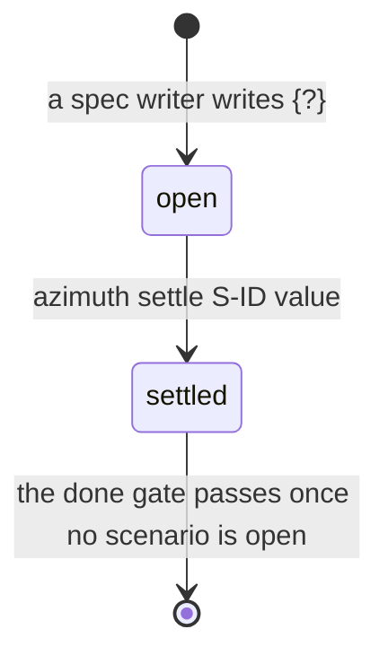

# F-008: Contract

## Data structures

```ts
// src/core/placeholders.ts (new). Imports no Node modules, so the viewer can use it.

/** A value the first passing test will settle. */
export const OPEN_PLACEHOLDER = "{?}";

/**
 * A settled value: "{=", at least one character other than "{", "}", "\r" or "\n", then "}".
 * Global; the value is group 1. `{=}` and `{=a{b}` are plain text.
 */
export const SETTLED_PLACEHOLDER: RegExp; // /\{=([^{}\r\n]+)\}/g

export type PlaceholderPart =
  | { kind: "text"; text: string }
  | { kind: "open" }
  | { kind: "settled"; value: string };

export type SettleOutcome =
  /** `text` is the new stories.md; `left` counts the scenario's placeholders still open. */
  | { ok: true; text: string; left: number }
  | { ok: false; reason: "no-scenario" | "no-placeholder" | "bad-value" };

/** One settle an agent logged: `Settled <scenario>: {=<value>}`. */
export interface SettleEntry {
  scenario: Id;
  value: string;
  at: ISODateTime;
}

// src/core/types.ts (index contract)
export interface FeatureDetail {
  /* existing fields unchanged */
  /** notes.md without its first "# " title line, trimmed; null without the file or content. */
  notes: Markdown | null;
}

// src/core/model.ts
export interface FeatureFiles {
  /* existing fields unchanged */
  notes: string | null; // repo-relative path of notes.md, or null when it doesn't exist
}
export interface FeatureEntity {
  /* existing fields unchanged */
  /** Same value as FeatureDetail.notes. Not part of `spec`, so never hashed. */
  notes: string | null;
}
```

`notes.md` (in the feature folder, created by the first `azimuth note`):

```markdown
# F-008: Notes

### T-008.2 · 2026-10-20

The heading starts at byte 17: the parser counts the BOM.

### F-008 · 2026-10-21

Split the parser in two.
```

A scenario's placeholders, in `stories.md`:

```markdown
### S-008.1.2 · Finds the heading {happy}
- **GIVEN** the text `# Hi` after a BOM
- **WHEN** it is parsed
- **THEN** the heading starts at byte {?}
- **AND** it ends at byte {=30}
```

## Public signatures

```ts
// src/core/placeholders.ts

/** The stories part as the hash reads it: every settled value replaced by OPEN_PLACEHOLDER. */
export function normalizePlaceholders(stories: string): string;

/**
 * IDs of the scenarios holding OPEN_PLACEHOLDER, in file order. A scenario's lines run from the
 * line after its "### S-…" heading to the next line starting with "## " or "### ", or the end
 * of the file; lines inside ``` or ~~~ fences are skipped (a heading there ends nothing).
 */
export function openPlaceholderScenarios(stories: string): string[];

/**
 * Replaces the scenario's first OPEN_PLACEHOLDER (same lines as above) with `{=<value>}`, the
 * value trimmed, and leaves every other character as it was. "bad-value" when the trimmed value
 * is empty or holds "{", "}" or a line break; checked before the scenario is looked up.
 */
export function settleText(stories: string, scenarioId: string, value: string): SettleOutcome;

/** Splits scenario text into plain text, open placeholders and settled values, in order. */
export function placeholderParts(text: string): PlaceholderPart[];

/** The log body of a settle: `Settled S-008.1.2: {=17..30}`. */
export function settleLogBody(scenarioId: string, value: string): string;

/**
 * Settles logged by an agent (type note, body exactly as settleLogBody writes it) after
 * `review_ack_at`, or all of them when it is null, oldest first.
 */
export function unreviewedSettles(f: {
  log: LogEntry[];
  review_ack_at: ISODateTime | null;
}): SettleEntry[];

// src/core/spec-hash.ts: signature unchanged. The stories part goes through
// normalizePlaceholders before normalize(); featureBody, impact and contract are hashed as written.
export function specHash(parts: SpecParts): string;

// src/core/notes.ts (new)
/**
 * notes.md after one more note: `existing` (or, when null or blank, a new "# <featureId>: Notes"
 * file) with its trailing whitespace trimmed, a blank line, "### <ref> · <date>", a blank line,
 * the trimmed text and a final newline.
 */
export function appendNoteText(
  existing: string | null,
  featureId: Id,
  ref: Id,
  date: ISODate,
  text: string,
): string;

/**
 * Appends a note for a feature or one of its tasks to the feature's notes.md, under the project
 * lock. Result: { ref, from: null, to: null, changed: [notes.md], auto: false,
 * message: "<ref>: note added" }.
 */
export function addNote(root: string, ref: string, text: string, opts: Who): Result;

// src/core/settle.ts (new)
/**
 * Settles the scenario's first open placeholder and appends a note entry
 * (settleLogBody, actor and session from opts) to the feature's log.md, both in one locked step.
 * Result: { ref: scenarioId, from: null, to: null, changed: [stories.md, log.md], auto: false,
 * message: "<S-ID>: settled <value>" plus " (<n> placeholder[s] left)" when n > 0 }.
 */
export function settleValue(root: string, scenarioId: string, value: string, opts: Who): Result;

// src/cli/commands/note.ts and src/cli/commands/settle.ts (new), added to COMMANDS in
// src/cli/main.ts after `log`. Both take --json (prints the Result) and record
// { touched: [<F-ID>, <ref>] } (just [<F-ID>] for a feature) in the current session.
export const note: Command;   // usage: 'note <T-ID | F-ID> "<text>"'
                              // summary: "Record what a task taught in the feature's notes.md (never makes the approval stale)"
export const settle: Command; // usage: 'settle <S-ID> "<value>"'
                              // summary: "Replace a scenario's first {?} with the value a passing test proved"

// src/core/gates.ts: doneGate adds, between done.scenarios-passing and done.as-built,
//   check("done.placeholders-settled", "Every placeholder value settled",
//         open.length === 0, open.join(", "))
// with open = openPlaceholderScenarios(f.spec?.stories ?? "").

// src/core/inbox.ts: for features in approved, in-progress, verifying or done, approved by you
// or by an agent, with settles = unreviewedSettles(f) not empty (one review-auto item per feature):
//   approved_by "agent" and review_ack_at null: the existing review-auto item's detail gains
//     " Settled by an agent: S-001.1.1: 17; S-001.2.1: 3..5."
//   otherwise (approved_by "you", or review_ack_at set): a review-auto item
//     { ref: <F-ID>, title: "<title>: <n> value[s] settled by an agent",
//       detail: "Settled S-001.1.1: 17; S-001.2.1: 3..5. Acknowledge them or send the spec back to draft."
//               ("Acknowledge it" when n is 1),
//       since: settles[0].at, urgency: "low" }

// src/core/transitions.ts: acknowledge(root, id, opts) keeps its signature. For a feature it
// accepts approved_by "agent" (as today) or unreviewedSettles(feature).length > 0, and otherwise
// throws AzimuthError("invalid", "<F-ID> has no automatic decision to acknowledge.") as today.

// src/core/delta.ts: userEventsSince reports a feature's review_ack_at as
//   "acknowledged the automatic approval of <F-ID>"   when approved_by is "agent" (as today)
//   "acknowledged the values settled in <F-ID>"        when approved_by is "you"

// viewer/src/screens/feature/featureData.ts
/** The As-built tab opens once the feature has an as-built or notes. */
export function asBuiltOpen(f: Feature): boolean;

// viewer/src/screens/feature/AsBuiltTab.tsx: after the as-built sections (or, before close-out,
// after the line "As-built is written at close-out, once <F-ID> reaches verifying."):
//   <section class="fd-ctx-sec"><h2 class="fd-sec-title">Notes</h2><Prose text={notes} /></section>
```

Markup `gwt` in `StoriesTab.tsx` renders for each placeholder, in plain text and inside code
spans alike:

```html
<!-- {=17} -->
<span class="fd-ph settled" title="settled by test">17<span class="fd-ph-mark" aria-hidden="true">✓</span><span class="sr-only"> (settled by test)</span></span>
<!-- {?} -->
<span class="fd-ph open" title="to be settled by the first passing test">to be settled</span>
```

CLI output:

```text
$ azimuth note T-008.2 "The heading starts at byte 17: the parser counts the BOM."
T-008.2: note added
$ azimuth settle S-008.1.2 17..30
S-008.1.2: settled 17..30 (1 placeholder left)
$ azimuth settle S-008.1.2 30
S-008.1.2: settled 30
```

Log entry written by `settle`:

```markdown
## 2026-10-20T10:00:00Z · agent · note · SES-20261020-0900
Settled S-008.1.2: {=17..30}
```

## Errors

Every refusal is an `AzimuthError` (exit 1, stderr `✗ <message>`) and writes nothing. A missing
argument is a usage error (exit 2).

| Command | Code        | Message                                                                 |
| ------- | ----------- | ----------------------------------------------------------------------- |
| note    | `invalid`   | `S-001.1.1 is not a feature or task.` (any ID other than F- or T-)      |
| note    | `invalid`   | `A note needs some text.`                                               |
| note    | `not-found` | `F-009 does not exist.`                                                 |
| note    | `not-found` | `T-001.9 is not a task in .azimuth/features/F-001-thing/plan.md.`       |
| settle  | `invalid`   | `T-001.1 is not a scenario ID.` (anything but S-NNN.n.m)                |
| settle  | `invalid`   | `A settled value can't be empty or contain {, } or a line break.`       |
| settle  | `not-found` | `F-009 does not exist.` (the scenario's feature)                        |
| settle  | `not-found` | `S-001.1.9 is not a scenario in .azimuth/features/F-001-thing/stories.md.` |
| settle  | `invalid`   | `S-001.1.1 has no {?} left to settle.`                                  |
| ack     | `invalid`   | `F-001 has no automatic decision to acknowledge.` (unchanged; now also when a feature you approved has no settles after `review_ack_at`) |

The done gate's new check, as `azimuth show F-008 --brief` and a refused `move F-008 done`
print it:

```text
  ✗ Every placeholder value settled — S-008.1.2, S-008.3.1
```

## State transitions


