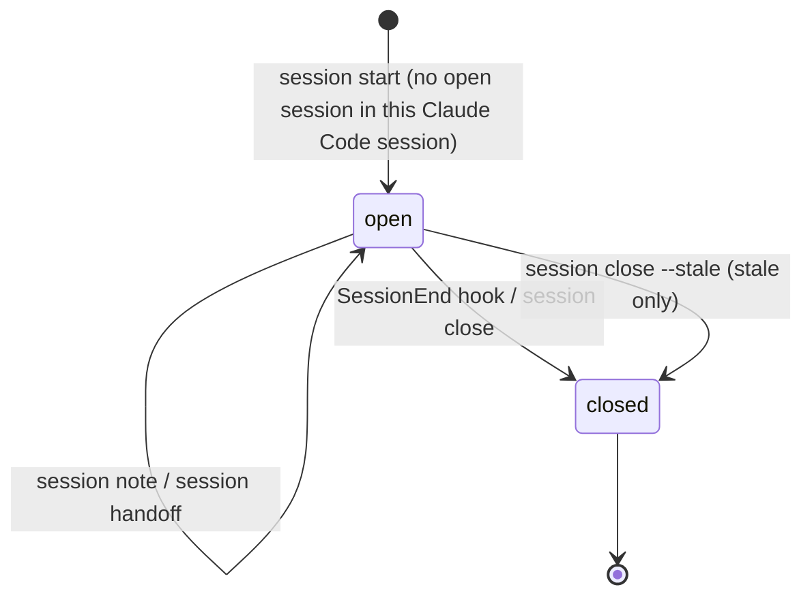

# F-011: Contract

## Data structures

```ts
// src/core/live.ts
/**
 * The sidecar of one Claude Code session's live log: `<liveDir>/<claude-session>.meta.json`,
 * named like `liveFile` (characters outside [\w.-] become "_"). Rewritten whole and atomically;
 * F-014 reads `transcript_path` from it through `readLiveMeta`.
 */
export interface LiveMeta {
  /** When the Claude Code session first started (its first SessionStart hook), UTC. Never changes once set. */
  started_at: ISODateTime | null;
  /** The Azimuth session last started (or reused) in this Claude Code session. */
  ses: Id | null;
  /** Claude Code's transcript (JSONL) path from the latest SessionStart input that had one. */
  transcript_path: string | null;
}

// src/core/types.ts (index contract)
export interface Session {
  /* existing fields unchanged */
  /** The `## Goals` section: one `- HH:MM · <skill> · <goal>` bullet per reusing start; "" when absent. */
  goals: Markdown;
  /** The `## Notes` section: one `- HH:MM · <text>` bullet per `session note`; "" when absent. */
  notes: Markdown;
}

// src/core/facts.ts
export interface Facts {
  /* existing fields unchanged */
  /**
   * Azimuth session ID → when the live log of the Claude Code session whose sidecar names it was
   * last written (its modification time, UTC). Sessions no sidecar names are absent.
   */
  sesLastSeen: Map<Id, ISODateTime>;
}

// src/hooks/handlers.ts
export interface HookInput {
  /* existing keys */
  /** Claude Code's transcript path, sent with every hook event. */
  transcript_path?: string;
}

// src/core/session.ts
/** An open session older than this is stale unless its Claude Code session is active. */
export const STALE_SESSION_MS = 12 * 3_600_000;
/** A Claude Code session whose live log was written this recently counts as active. */
export const ACTIVE_CLAUDE_MS = 3_600_000;
```

Sidecar on disk (`.azimuth/cache/live/c1.meta.json`, or the main worktree's cache):

```json
{
  "started_at": "2026-10-20T09:00:00Z",
  "ses": "SES-20261020-0900",
  "transcript_path": "/Users/me/.claude/projects/-Users-me-shop/c1.jsonl"
}
```

A session reused twice and given notes (`.azimuth/sessions/SES-20261020-0900.md`):

```markdown
---
id: SES-20261020-0900
agent: claude-code
skill: spec
started_at: 2026-10-20T09:00:00Z
ended_at: 2026-10-20T13:12:00Z
goal: Spec F-011
touched: [F-011, T-011.1]
commits: [a41f2b9]
raised: []
---
## Summary

## Handoff
Build T-011.3 next.

## Goals
- 10:15 · build · Build F-011
- 11:40 · Triage BUG-0003

## Notes
- 10:30 · T-011.2 green; starting T-011.3
```

## Public signatures

```ts
// src/core/live.ts
/** `<liveDir>/<sanitized claude-session>.meta.json`. */
export function liveMetaFile(root: string, claudeSession: string): string;

/**
 * The sidecar, or null when it is missing, isn't JSON or isn't an object. A field that isn't a
 * string reads as null.
 */
export function readLiveMeta(root: string, claudeSession: string): LiveMeta | null;

/**
 * Merges `patch` into the sidecar (creating it with null fields) and writes it atomically.
 * Keys whose value is undefined are ignored; an existing `started_at` is kept.
 */
export function updateLiveMeta(
  root: string,
  claudeSession: string,
  patch: Partial<LiveMeta>,
): LiveMeta;

/**
 * As before, except that `ses` and `started_at` come from the sidecar when it has them, and from
 * the records (the last `session` record, the first record) otherwise. Callers that know the
 * sidecar pass it: readLiveSessions, and the SessionStart and PostToolUse hooks.
 */
export function summarizeLive(
  claudeSession: string,
  records: LiveRecord[],
  meta?: LiveMeta | null,
): LiveSession | null;

/** Each sidecar's `ses` → its live log's modification time (UTC); the latest wins for a shared `ses`. */
export function sessionsLastSeen(root: string): Map<Id, ISODateTime>;

// src/core/session.ts
/**
 * The Azimuth session last started in a Claude Code session: the sidecar's `ses`, else the last
 * `session` record in the live log's tail.
 */
export function sessionOfClaude(root: string, claudeSession: string): string | null;

/** `AZIMUTH_SESSION`, else `sessionOfClaude` for the Claude Code session in the environment. */
export function currentSession(root: string, env: SessionEnv): string | null;

/**
 * With a Claude Code session whose Azimuth session exists and is open (ended_at null): appends
 * `- HH:MM · <skill> · <goal>` (`- HH:MM · <goal>` without a skill) to its `## Goals` section,
 * merges `touched`, and returns its ID. Otherwise creates `SES-YYYYMMDD-HHMM[-n]` as before.
 * With a Claude Code session, either way appends `{ kind: "session", at, ses }` to the live log
 * and sets the sidecar's `ses`.
 */
export function startSession(root: string, opts: StartOptions): string;

/**
 * Appends `- HH:MM · <text>` (UTC; whitespace runs collapsed to one space) to the session's
 * `## Notes` section, creating the section at the end of the body. Returns the session's file.
 */
export function appendNote(root: string, id: string | null, text: string, now?: Date): string;

/**
 * Sets ended_at and collects the commits made since the start, as before, reading only this
 * session's file, the config and one `readCommits` (no loadProject), so SessionEnd can call it.
 */
export function closeSession(root: string, id: string | null, now?: Date): string;

/**
 * Open, started more than STALE_SESSION_MS before `now`, and its Claude Code session not written
 * to within ACTIVE_CLAUDE_MS (`lastSeen` undefined counts as not active).
 */
export function sessionStale(
  session: Pick<Session, "started_at" | "ended_at">,
  now: Date,
  lastSeen: ISODateTime | undefined,
): boolean;

/**
 * Closes every stale session (sessionStale with sessionsLastSeen(root)), ending each at
 * min(now, max(started_at + STALE_SESSION_MS, lastSeen)). Returns the closed files.
 */
export function closeStaleSessions(root: string, now?: Date): string[];

// src/hooks/handlers.ts
// sessionStart: after the `start` record, updateLiveMeta(root, id, { started_at: <now>,
//   transcript_path: input.transcript_path }); the compaction note uses
//   summarizeLive(id, records, readLiveMeta(root, id)).
// postToolUse: summarizeLive(id, records, readLiveMeta(root, id)).
// sessionEnd: appends `end`, then closeSession(root, sessionOfClaude(root, id), now) when that
//   session's file exists and its ended_at is null.

// src/core/validate.ts: sessionProblems reports W-SESSION-OPEN for each session where
//   sessionStale(s, facts.now, facts.sesLastSeen.get(s.id)).
// src/core/build-index.ts: analyzeProject sets facts.sesLastSeen = sessionsLastSeen(root).
```

CLI (`src/cli/commands/work.ts`):

```text
azimuth session <start --skill <name> --goal "…" [--touch IDs] | note "<text>" | handoff "<next steps>" [--summary "…"] | close [--stale]> [--id SES-…]

$ azimuth session start --skill build --goal "Build F-011" --touch F-011
SES-20261020-0900                       (the open session's ID when reused; --json: {"id":"SES-20261020-0900"})
$ azimuth session note "T-011.2 green; starting T-011.3"
Updated .azimuth/sessions/SES-20261020-0900.md
```

## Errors

No new error variants.

| Case | Exit | stderr |
| --- | --- | --- |
| `session note` without text | 2 (UsageError) | `session note needs "<text>".` then the usage line |
| `session note` with no current session and no `--id` | 1 (AzimuthError `invalid`) | ``✗ No current session. Start one with `azimuth session start` or pass --id.`` |
| `session note --id` naming a missing session | 1 (AzimuthError `not-found`) | `✗ SES-… does not exist.` |
| Unknown action | 2 (UsageError) | `Unknown session action "<action>". Use start, note, handoff or close.` |
| No action | 2 (UsageError) | `Missing <start\|note\|handoff\|close>.` |

The hooks never fail the Claude Code session: a sidecar write or a close that throws is logged to
`hooks.log` by the hook runner, which exits 0 (unchanged). An unreadable sidecar is treated as
missing.

## State transitions


