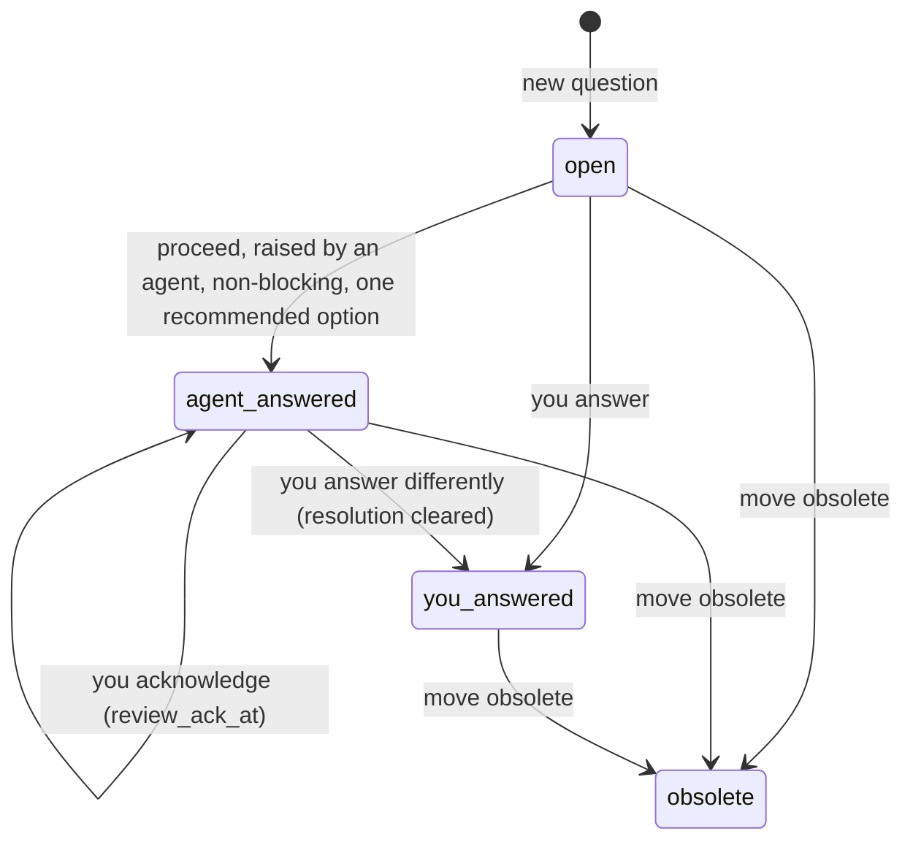

# F-012: Contract

## Data structures

```ts
// src/core/types.ts
export const QUESTION_AUTONOMY = ["ask", "proceed"] as const;
export type QuestionAutonomy = (typeof QUESTION_AUTONOMY)[number];

export interface Autonomy {
  approve_specs: AutonomyLevel;
  accept_adrs: AutonomyLevel;
  /**
   * ask: only you answer questions. proceed: a new non-blocking question an agent raises with
   * exactly one recommended option is answered with it at once (answer.by: agent).
   */
  questions: QuestionAutonomy;
  /** When true, auto-approval also requires zero warnings in the feature. */
  strict: boolean;
}

export interface Question {
  /* id … options: unchanged */
  answer: null | {
    option: string | null;
    text: string;
    answered_at: ISODateTime;
    /** Who answered. Files written before F-012 have no `by`, which means you. */
    by: Actor;
  };
  resolution: null | { kind: "assumption" | "adr"; ref: Id };
  /** Set when you acknowledge an agent's answer; null otherwise (also when the key is absent). */
  review_ack_at: ISODateTime | null;
  file: string;
}
```

```ts
// src/core/config.ts
export const DEFAULT_CONFIG: Config = {
  /* … */
  autonomy: { approve_specs: "auto", accept_adrs: "auto", questions: "ask", strict: false },
  /* … */
};
// SHAPE.autonomy gains: questions: r.oneOf(QUESTION_AUTONOMY)
```

```yaml
# Written by configYaml (src/core/init.ts), between accept_adrs and strict:
autonomy:
  questions: ask # ask: only you answer; proceed: agents take their own recommendation on non-blocking questions
```

```yaml
# questions/Q-NNNN.md after an automatic answer (keys the CLI writes)
status: answered
answer:
  option: a
  text: ""
  answered_at: 2026-10-20T09:00:00Z
  by: agent # you | agent; absent means you
review_ack_at: 2026-10-20T10:00:00Z # written by `ack` / the viewer's Acknowledge; absent until then
```

```markdown
<!-- The feature's log.md, when the question names a feature -->
## 2026-10-20T09:00:00Z · agent · note · SES-20261020-0900 · auto

Q-0001 answered with its recommendation: Lockfile
```

## Public signatures

```ts
// src/core/transitions.ts

/**
 * Under autonomy.questions: proceed, answers a question an agent has just raised with its one
 * recommended option: status answered, answer {option, text: "", answered_at, by: "agent"},
 * plus an `· auto` note in the question's feature's log. Returns null and writes nothing when
 * the question has to wait for you: the mode is ask, the actor is you, the question is
 * blocking or not open, or it doesn't have exactly one recommended option.
 * Result: {ref, from: "open", to: "answered", changed, auto: true,
 *          message: "Q-0001: answered automatically with its recommendation (a: Lockfile)"}.
 */
export function proceedWithRecommendation(root: string, id: string, opts: Who): Result | null;

/**
 * Unchanged signature. Writes `by: "you"`. You may also answer a question whose answer.by is
 * agent: the answer is replaced, resolution is cleared, and the message is
 * "Q-0001: answered, replacing the agent's answer" (otherwise "Q-0001: answered").
 */
export function answerQuestion(
  root: string,
  id: string,
  answer: { option?: string | null; text?: string },
  opts: Who,
): Result;

/** Also accepts a Q-ID whose answer.by is agent; writes the question's review_ack_at. */
export function acknowledge(root: string, id: string, opts: Who): Result;

// src/core/next.ts
/** Questions you answered (answer.by: you) that no agent has applied yet. */
export function pendingAnswers(index: Index): Question[];
```

```ts
// src/core/inbox.ts: one item per question with status answered, answer.by agent and no review_ack_at
const item: InboxItem = {
  kind: "review-auto",
  ref: "Q-0001",
  title: "Which lock?", // the question's title
  detail: "Answered by an agent with its recommendation: Lockfile. Acknowledge it or answer differently.",
  since: "2026-10-20T09:00:00Z", // answer.answered_at
  urgency: "low",
};

// src/core/delta.ts
// - answers with by: agent produce no event;
// - review_ack_at on a question after the cursor produces
//   {ref: "Q-0001", feature: q.feature, text: "acknowledged the automatic answer to Q-0001"}.
```

```text
# src/core/brief.ts, status --brief line 2
Autonomy: specs auto, decisions auto, questions proceed[ · Viewer: <url>]

# src/cli/commands/write.ts
new question … (usage unchanged). When proceedWithRecommendation answers it, the text output is:
  Q-0001 created: .azimuth/questions/Q-0001.md
  Q-0001: answered automatically with its recommendation (a: Lockfile)
  Proceed with it and record it with azimuth resolve Q-0001. The user can overrule it in the viewer.
--json: {"id": "Q-0001", "files": [".azimuth/questions/Q-0001.md"], "answered": Result | null}
  ("answered" is present for questions only)

ack <F-ID | ADR-ID | Q-ID>
  summary: Acknowledge an automatic approval, acceptance or answer (you only)
answer <Q-ID> [--option <key>] [--text "…"]
  summary: Answer a question, or replace an agent's answer (you only)
```

```text
# Viewer strings
Questions screen, an answer with by: agent:
  answer head label "Answered by an agent with its recommendation"; the chosen card's badge
  "Agent's answer"; a button "Answer differently" that shows the AnswerComposer below it.
Inbox, review-auto item whose ref is a Q-ID:
  buttons "Answer differently" (expands the inline AnswerComposer) and "Acknowledge".
  Features and ADRs keep "Send back…" and "Acknowledge".
Inbox aside "Recently cleared": only answers with by: you ("You answered Q-…").
Overview recent activity: lead "Agent answered" for by: agent, "You answered" for by: you.
```

## Errors

| Where | Condition | Error |
| --- | --- | --- |
| `parseConfig` | `autonomy.questions` is not `ask` or `proceed` | `E-SCHEMA` "autonomy.questions must be ask or proceed."; the value falls back to `ask` |
| `parseQuestion` | `answer.by` is present and not `you` or `agent` | `E-SCHEMA` "answer must be {option, text, answered_at, by: you \| agent} (got …)."; the question is left out of the index |
| `answerQuestion` | actor is `agent` | `policy` "Only the user answers questions. Leave Q-0001 open and ask them." (unchanged) |
| `answerQuestion` | answered `by: you`, or obsolete | `conflict` "Q-0001 is already answered." / "Q-0001 is already obsolete." (unchanged) |
| `acknowledge` | a question not answered by an agent | `invalid` "Q-0001 has no automatic decision to acknowledge." |
| `acknowledge` | actor is `agent` | `policy` "Only the user acknowledges automatic decisions." (unchanged) |
| `proceedWithRecommendation` | unknown ID | `not-found` "Q-0001 does not exist." |

`proceedWithRecommendation` never fails because of the question's state or the mode; it returns
`null` instead.

## State transitions

The file's `status` stays `answered` in both answered states; `answer.by` tells them apart.


