# F-014: Contract

## Data structures

```ts
// src/core/types.ts (index contract; no Node imports)
export type AgentStatus = "running" | "waiting" | "done";

/** What an agent waits on you for, and since when. */
export interface LiveWait {
  /** "Permission prompt: Bash pnpm vitest run" | "Permission prompt: <notification message>" | "Waiting for your next prompt" */
  reason: string;
  since: ISODateTime;
}

/** A stretch of time an agent waited on you; `to` is null while it lasts. */
export interface LiveWaitSpan {
  from: ISODateTime;
  to: ISODateTime | null;
  reason: string;
}

/** One successful Edit, MultiEdit, Write or NotebookEdit. */
export interface LiveEdit {
  file: string;
  at: ISODateTime;
  /** Null when the hook couldn't count (NotebookEdit, logs written before F-014). */
  added: number | null;
  removed: number | null;
}

export interface LiveEvent {
  at: ISODateTime;
  tool: string;
  file: string | null;
  summary: string;
  agent_id: string | null;
  /** Lines an Edit, MultiEdit or Write added and removed; null otherwise. */
  added: number | null;
  removed: number | null;
  /** First line of the error of a failed tool (PostToolUseFailure); null otherwise. */
  error: string | null;
}

/** What one agent is doing: a session's main agent (LiveSession.main) or a subagent. */
export interface LiveActivity {
  status: AgentStatus;
  /** Set exactly when status is "waiting". */
  waiting: LiveWait | null;
  /** This agent's latest tool event. */
  current: LiveEvent | null;
  /** Main agent: the session's started_at. Subagent: its `subagent` record, else its first record. */
  started_at: ISODateTime;
  /** Set exactly when status is "done": the end, the subagent's stop, or its last record. */
  ended_at: ISODateTime | null;
  /** Its last MAX_EDITS edits, oldest first. */
  edits: LiveEdit[];
  /** Its last MAX_WAITS wait spans, oldest first (permission waits; idle spans for the main agent). */
  waits: LiveWaitSpan[];
  /** Whether a transcript path is recorded (or derived) and the file exists. */
  transcript: boolean;
}

export interface LiveAgent extends LiveActivity {
  /* F-005 fields unchanged: agent_id, agent_type, last_seen_at, description, task, feature, stopped_at */
}

export interface LiveSession {
  /* Existing fields unchanged; `current` stays the latest tool event of any agent. */
  /** The main agent's own activity. */
  main: LiveActivity;
  /** The session as a whole (see State transitions). */
  status: AgentStatus;
  /** The earliest open permission wait of any agent, else the main agent's idle wait; null unless status is "waiting". */
  waiting: LiveWait | null;
  /** The Azimuth session's latest goal and skill (latestGoal); null without a session file. */
  goal: string | null;
  skill: string | null;
}

// Transcript API (GET /api/transcript), here so the viewer can import the types.
export type TranscriptStatus = "running" | "ok" | "error";

export interface TranscriptText {
  lines: string[];
  /** More lines existed than the cap. */
  truncated: boolean;
}

export interface TranscriptDiff extends TranscriptText {
  /** "+" and "-" lines over the whole patch, before the cap. */
  added: number;
  removed: number;
}

export type TranscriptEntry =
  | { kind: "message"; role: "user" | "assistant"; text: string; at: string | null }
  | {
      kind: "tool";
      tool_use_id: string;
      name: string;
      /** toolTarget of the call. */
      target: string;
      /** The call's `description` input (Bash), else null. */
      summary: string | null;
      status: TranscriptStatus;
      /** Edit, MultiEdit, Write: from the result's structuredPatch (a created file: its content as "+" lines). */
      diff: TranscriptDiff | null;
      /** Bash: stdout then stderr (tail); a failed tool: its result text (tail); otherwise null. */
      output: TranscriptText | null;
      at: string | null;
    }
  | {
      /** An Agent (or Task) call: a subagent card. */
      kind: "spawn";
      tool_use_id: string;
      description: string;
      /** The call's `subagent_type`. */
      agent_type: string | null;
      /** The result's `toolUseResult.agentId`, when known. */
      agent_id: string | null;
      status: TranscriptStatus;
      /** The subagent's returned text (head). */
      output: TranscriptText | null;
      at: string | null;
    }
  | {
      /** A tool result whose call isn't in this page (the viewer updates the earlier entry). */
      kind: "result";
      tool_use_id: string;
      status: "ok" | "error";
      diff: TranscriptDiff | null;
      output: TranscriptText | null;
      agent_id: string | null;
      at: string | null;
    };

export interface TranscriptPage {
  ok: true;
  claude_session: string;
  agent: string | null;
  entries: TranscriptEntry[];
  /** Byte offset to pass as `after` for the next page. */
  next: number;
  /** Content between the start (byte 0, or `after`) and the first line read was not returned. */
  skipped: boolean;
}

// src/core/live.ts
export type LiveRecord =
  | /* start, launch, subagent, session, prompt, stop, end, cursor: unchanged */
  | {
      kind: "tool";
      at: string;
      tool: string;
      file: string | null;
      summary: string;
      agent_id?: string | null;
      agent_type?: string | null;
      tool_use_id?: string | null;
      spawned?: string | null;
      /** Edit, MultiEdit, Write: editSize, when known. */
      added?: number;
      removed?: number;
      /** PostToolUseFailure. */
      failed?: boolean;
      error?: string;
    }
  | { kind: "subagent-stop"; at: string; agent_id: string; transcript_path?: string | null }
  /** PermissionRequest, and Notification of type permission_prompt. */
  | {
      kind: "wait";
      at: string;
      source: "permission" | "notification";
      reason: string;
      tool: string | null;
      target: string | null;
      /** Null: the main agent (permission) or an unknown agent (notification). */
      agent_id: string | null;
    };

// Retention: readLiveSessions and pruneLive keep logs (and sidecars) touched in the last 72 h.
//   const KEEP_MS = 72 * 3_600_000;
// sessionOpen (process-ID trust) and anySessionOpen keep 24 h:
//   const OPEN_MS = 24 * 3_600_000;

// src/core/live-agents.ts (pure: no I/O)
export const DONE_AFTER_MS = 30 * 60_000;
export const MAX_EDITS = 5;
export const MAX_WAITS = 20;
export const IDLE_REASON = "Waiting for your next prompt";

export interface Activity {
  main: LiveActivity;
  /** Every agent ID seen in a subagent, subagent-stop, tool or wait record. */
  agents: Map<string, LiveActivity>;
  status: AgentStatus;
  waiting: LiveWait | null;
}

// src/core/tools.ts
export interface EditSize {
  added: number;
  removed: number;
}

// src/core/transcript.ts
export const TRANSCRIPT_WINDOW_BYTES = 512 * 1024;
export const TRANSCRIPT_DIFF_LINES = 80;
export const TRANSCRIPT_OUTPUT_LINES = 40;
export const TRANSCRIPT_TEXT_CHARS = 8_000;
export const TRANSCRIPT_LINE_CHARS = 500;

export interface TranscriptWindow {
  /** Complete lines (without "\n"), in file order. */
  lines: string[];
  next: number;
  skipped: boolean;
}

// src/hooks/handlers.ts
export interface HookInput {
  /* existing keys, and F-011's transcript_path */
  agent_transcript_path?: string;
  notification_type?: string;
  message?: string;
  title?: string;
  error?: string;
}

// src/server/server.ts
export interface ServerOptions {
  /* existing keys */
  /** Folders transcripts may be served from (default: defaultTranscriptRoots(process.env, homedir())). */
  transcriptRoots?: string[];
  /** How often live statuses are re-derived while a client is connected (default 60_000). */
  statusRefreshMs?: number;
}
```

Live records on disk (one JSON object per line):

```json
{"kind":"wait","at":"2026-10-20T10:02:00Z","source":"permission","reason":"Permission prompt: Bash pnpm vitest run","tool":"Bash","target":"pnpm vitest run","agent_id":null}
{"kind":"wait","at":"2026-10-20T10:02:06Z","source":"notification","reason":"Permission prompt: Claude needs your permission to use Bash","tool":null,"target":null,"agent_id":null}
{"kind":"tool","at":"2026-10-20T10:03:00Z","tool":"Edit","file":"src/a.ts","summary":"Edited src/a.ts","agent_id":"a1","agent_type":"general-purpose","added":2,"removed":1}
{"kind":"tool","at":"2026-10-20T10:04:00Z","tool":"Bash","file":null,"summary":"pnpm build","agent_id":null,"agent_type":null,"failed":true,"error":"Exit code 1"}
{"kind":"subagent-stop","at":"2026-10-20T10:05:00Z","agent_id":"a1","transcript_path":"/Users/me/.claude/projects/-Users-me-shop/c1/subagents/agent-a1.jsonl"}
```

`plugin/hooks/hooks.json` additions:

```json
"PermissionRequest": [{ "hooks": [{ "type": "command", "command": "\"${CLAUDE_PLUGIN_ROOT}/bin/azimuth\" hook permission-request", "timeout": 5 }] }],
"Notification": [{ "hooks": [{ "type": "command", "command": "\"${CLAUDE_PLUGIN_ROOT}/bin/azimuth\" hook notification", "async": true }] }],
"PostToolUseFailure": [{ "matcher": "*", "hooks": [{ "type": "command", "command": "\"${CLAUDE_PLUGIN_ROOT}/bin/azimuth\" hook post-tool-use-failure", "async": true }] }]
```

## Public signatures

```ts
// src/core/tools.ts
/** Lines in a text: "" has 0, a final "\n" doesn't start another line. */
export function lineCount(text: string): number;

/**
 * A structuredPatch (hunks {oldStart, oldLines, newStart, newLines, lines}) as diff lines: per
 * hunk an "@@ -oldStart,oldLines +newStart,newLines @@" header then its lines, with the counts of
 * "+" and "-" lines. Null when `patch` isn't a non-empty array of hunks.
 */
export function patchLines(
  patch: unknown,
): { lines: string[]; added: number; removed: number } | null;

/**
 * Lines an Edit, MultiEdit or Write added and removed: from the response's structuredPatch when
 * it has a hunk, else from the input (Edit: new_string/old_string; MultiEdit: the sum over
 * edits[]; Write: content, removed 0). Null for other tools or when the input has no strings.
 */
export function editSize(
  tool: string,
  input: Record<string, unknown> | undefined,
  response: unknown,
): EditSize | null;

/**
 * What a call acts on, for wait reasons and transcripts: Bash's first command line (whitespace
 * collapsed, tidyPaths, 120 characters); Read, Edit, MultiEdit, Write, NotebookEdit and any other
 * tool with file_path/notebook_path/path: its display path (relative in the project, tidied
 * outside); Grep and Glob: pattern; WebFetch: the URL's host; WebSearch: query; Agent and Task:
 * description (each clipped to 120); otherwise "".
 */
export function toolTarget(
  root: string,
  tool: string,
  input: Record<string, unknown> | undefined,
  places: Omit<Places, "root">,
): string;

// src/core/live-agents.ts
/** A tool record as an index event (added, removed and error null when absent). */
export function toLiveEvent(record: Extract<LiveRecord, { kind: "tool" }>): LiveEvent;

/**
 * Each agent's activity from one session's records, at `now` (rules in State transitions and
 * feature.md Assumptions). `startedAt` is the session's start (sidecar or first record);
 * `transcript` is false everywhere (readLiveSessions sets it).
 */
export function deriveActivity(records: LiveRecord[], now: Date, startedAt: string): Activity;

/** Goal and skill: the last `## Goals` bullet, else the frontmatter goal ("" → null) and skill. */
export function latestGoal(session: Pick<Session, "goal" | "skill" | "goals">): {
  goal: string | null;
  skill: string | null;
};

// src/core/live.ts
/**
 * As in F-011, plus: events carry added/removed/error; each agent (also those seen only in a wait
 * record) and `main` carry deriveActivity's activity; `status` and `waiting` are the session's;
 * `goal`, `skill` null and `transcript` false (readLiveSessions fills them).
 */
export function summarizeLive(
  claudeSession: string,
  records: LiveRecord[],
  meta?: LiveMeta | null,
  now?: Date,
): LiveSession | null;

/**
 * Sessions whose log was touched in the last 72 h, most recently active first, summarized at
 * `now` with their sidecar; `goal`/`skill` from `.azimuth/sessions/<ses>.md` when `ses` matches
 * ID_PATTERNS.session and the file parses; `transcript` true when transcriptPathOf gives a path
 * that exists.
 */
export function readLiveSessions(root: string, now?: Date): LiveSession[];

/**
 * The transcript recorded for an agent: the main agent (`agentId` null) → meta.transcript_path;
 * a subagent → its latest subagent-stop's transcript_path, else
 * `<dirname(main)>/<basename(main, ".jsonl")>/subagents/agent-<id>.jsonl` when the main path ends
 * in ".jsonl". Null when nothing is recorded or `agentId` isn't [A-Za-z0-9_-]{1,64}. No I/O.
 */
export function transcriptPathOf(
  meta: LiveMeta | null,
  records: LiveRecord[],
  agentId: string | null,
): string | null;

/** Deletes live files untouched for more than 72 hours (was 24). */
export function pruneLive(root: string, now?: Date): void;

// src/core/transcript.ts
/**
 * Complete lines of a transcript. Without `after`: the lines lying entirely within the last
 * `windowBytes` bytes; `skipped` when content before the first of them wasn't returned; `next`
 * just after the last line end in the window (for a non-empty file whose window holds no line
 * end: the file size, with `skipped` true; for an empty file: 0). With `after`: the
 * complete lines from `after` within `windowBytes`; when none ends in the window and the file
 * goes on, scans to the end of that line and returns no lines, `next` after it and `skipped`
 * true; at the end of the file, no lines and `next` = `after`.
 * Throws AzimuthError("invalid") when `after` isn't an integer from 0 to the file size.
 */
export function readTranscriptWindow(
  path: string,
  after: number | null,
  windowBytes?: number,
): TranscriptWindow;

/** Claude Code transcript lines → entries (rules in feature.md Assumptions). Never throws. */
export function normalizeTranscript(lines: string[], places: Places): TranscriptEntry[];

// src/hooks/handlers.ts (registered in HOOKS as "permission-request", "notification",
// "post-tool-use-failure"). Each returns { exitCode: 0 } with no stdout or stderr.
/** Appends a permission wait: reason "Permission prompt: <tool_name>[ <target>]". */
export function permissionRequest(input: HookInput, ctx: HookContext): HookOutput;
/** Only for notification_type "permission_prompt": a notification wait, reason "Permission prompt[: <message>]". */
export function notification(input: HookInput, ctx: HookContext): HookOutput;
/** A tool record with failed: true and error: the error's first line (trimmed, 120 characters; "Failed" when blank). */
export function postToolUseFailure(input: HookInput, ctx: HookContext): HookOutput;
// postToolUse: Edit, MultiEdit and Write records gain added/removed from
//   editSize(tool_name, tool_input, tool_response) when it isn't null.
// subagentStop: the record gains transcript_path: input.agent_transcript_path ?? null.

// src/server/transcript.ts
/** [`$CLAUDE_CONFIG_DIR/projects` when set, `<home>/.claude/projects`]. */
export function defaultTranscriptRoots(env: { CLAUDE_CONFIG_DIR?: string }, home: string): string[];

export type TranscriptOutcome =
  | { status: 200; body: TranscriptPage }
  | {
      status: 400 | 403 | 404;
      body: { ok: false; error: "invalid" | "forbidden" | "not-found"; message: string };
    };

/**
 * One page of a live session's transcript: checks the agent and offset, finds the recorded path
 * (readLiveMeta, readLiveRecords, transcriptPathOf), checks its real path against `roots`, reads
 * a window and normalises it with places { root, home }.
 */
export function serveTranscript(req: {
  root: string;
  claudeSession: string;
  agent: string | null;
  after: string | null;
  roots: string[];
  home: string;
}): TranscriptOutcome;
```

CLI usage (`src/cli/commands/harness.ts`):

```text
hook <session-start|pre-tool-use|post-tool-use|post-tool-use-failure|permission-request|notification|check-edit|user-prompt-submit|stop|subagent-start|subagent-stop|session-end>
```

HTTP:

```text
GET /api/transcript/<claude-session>[?agent=<agent-id>][&after=<byte offset>]
x-azimuth-token: <the page's token>

200 {"ok":true,"claude_session":"c1","agent":null,"entries":[…],"next":48213,"skipped":false}
```

## Errors

No new error variants. `readTranscriptWindow` throws `AzimuthError("invalid", "after must be a
byte offset between 0 and <size>.")`.

`GET /api/transcript/<claude-session>`, checked in this order:

| Case | Status | Body |
| --- | --- | --- |
| `Host` isn't the server's own address | 403 | `{ok: false, error: "host"}` (unchanged) |
| Session ID outside `[A-Za-z0-9_.-]{1,128}` (no route matches) | 404 | `{ok: false, error: "not-found"}` (unchanged fallback) |
| Missing or wrong `x-azimuth-token` | 403 | `{ok: false, error: "token"}` |
| `agent` outside `[A-Za-z0-9_-]{1,64}`; `after` not digits | 400 | `{ok: false, error: "invalid", message}` |
| No live log `live/<claude-session>.jsonl` in this project | 404 | `{ok: false, error: "not-found", message}` |
| `agent` not in any subagent, subagent-stop, tool or wait record of the log's tail | 404 | `{ok: false, error: "not-found", message}` |
| No recorded or derivable path, or no file at it | 404 | `{ok: false, error: "not-found", message}` |
| Real path not a regular file ending in `.jsonl` under a real allowed root | 403 | `{ok: false, error: "forbidden", message}` |
| `after` greater than the file size | 400 | `{ok: false, error: "invalid", message}` |

The hooks never fail the Claude Code session: malformed input or a failed append is logged to
`hooks.log` by the hook runner, which exits 0 (unchanged). A transcript line that isn't JSON, or
JSON of an unknown shape, is skipped.

## State transitions

Each agent's status (main agent and subagents). The session is `waiting` when any agent has an
open permission wait, else `running` when any agent runs, else `waiting` when the main agent
waits for your prompt, else `done`. Turn records are `start`, `prompt`, `stop`, `launch` and the
main agent's `tool` records; "quiet" is more than DONE_AFTER_MS (30 min) without a record (the
session's records for the main agent, the subagent's own records for a subagent).

```mermaid
stateDiagram-v2
  [*] --> running: start / subagent / first tool
  running --> waiting: wait record (permission)
  running --> waiting: stop (main agent, idle)
  waiting --> running: the agent's next tool record (permission)
  waiting --> running: prompt, tool, launch or start (main agent, idle)
  running --> done: end / subagent-stop / quiet
  waiting --> done: end / subagent-stop (subagent)
  waiting --> done: quiet (idle only; permission waits never expire)
  done --> running: start after end (main agent, resumed)
  done --> [*]
```



## Transcript fixture

`test/fixtures/transcripts/c1.jsonl`, one JSON object per line, written for root `/work/demo`
(tests copy it and replace `/work/demo` with their project root). Timestamps are
`2026-10-20T10:MM:SS.000Z`; every user and assistant entry has `type`, `uuid`, `parentUuid`,
`timestamp`, `sessionId: "c1"` and `isSidechain: false`. No real content.

| # | Entry | Content |
| --- | --- | --- |
| 1 | user, 10:00:00 | `message.content: "Build T-001.1"` |
| 2 | attachment | `{type: "attachment", attachment: {type: "hook", content: "FIXTURE-ATTACHMENT"}}` |
| 3 | assistant, 10:00:05 | `[{type: "thinking", thinking: "FIXTURE-THINKING"}, {type: "text", text: "Reading the module first."}]` |
| 4 | assistant, 10:00:06 | `tool_use {id: "toolu_read", name: "Read", input: {file_path: "/work/demo/src/a.ts"}}` |
| 5 | user, 10:00:07 | `tool_result {tool_use_id: "toolu_read", content: "FIXTURE-FILE-TEXT"}`; `toolUseResult: {type: "text", file: {filePath: "/work/demo/src/a.ts", content: "FIXTURE-FILE-TEXT"}}` |
| 6 | assistant, 10:00:10 | `tool_use {id: "toolu_edit", name: "Edit", input: {file_path: "/work/demo/src/a.ts", old_string: "b", new_string: "c\nd"}}` |
| 7 | user, 10:00:11 | `tool_result {tool_use_id: "toolu_edit", content: "The file has been updated."}`; `toolUseResult: {filePath, oldString: "b", newString: "c\nd", originalFile: "FIXTURE-ORIGINAL-FILE", structuredPatch: [{oldStart: 1, oldLines: 3, newStart: 1, newLines: 4, lines: [" a", "-b", "+c", "+d", " e"]}]}` |
| 8 | (not JSON) | `{not json` |
| 9 | assistant, 10:00:20 | `tool_use {id: "toolu_bash", name: "Bash", input: {command: "pnpm vitest run", description: "Run the tests"}}` |
| 10 | user, 10:00:25 | `tool_result {tool_use_id: "toolu_bash", content: "…", is_error: false}`; `toolUseResult: {stdout: "RUN v3\n✓ S-001.1.1 adds\nTest Files 1 passed", stderr: "", interrupted: false}` |
| 11 | assistant, 10:00:30 | `tool_use {id: "toolu_agent", name: "Agent", input: {description: "Find callers", prompt: "Find every caller of decide()", subagent_type: "Explore"}}` |
| 12 | user, 10:01:30 | `tool_result {tool_use_id: "toolu_agent", content: [{type: "text", text: "Found 1 caller: src/b.ts"}]}`; `toolUseResult: {agentId: "a1", status: "completed"}` |
| 13 | assistant, 10:01:40 | `tool_use {id: "toolu_fail", name: "Bash", input: {command: "pnpm lint"}}` |
| 14 | user, 10:01:45 | `tool_result {tool_use_id: "toolu_fail", content: "Exit code 1\nsrc/a.ts:3 error", is_error: true}`; `toolUseResult: "Error: Exit code 1"` |
| 15 | assistant, 10:01:50 | `tool_use {id: "toolu_run", name: "Bash", input: {command: "pnpm build"}}` (no result) |
| 16 | summary | `{type: "summary", summary: "FIXTURE-SUMMARY"}` |

`test/fixtures/transcripts/c1/subagents/agent-a1.jsonl` (`isSidechain: true`, `agentId: "a1"`):

| # | Entry | Content |
| --- | --- | --- |
| 1 | user, 10:00:31 | `message.content: "Find every caller of decide()"` |
| 2 | assistant, 10:00:40 | `tool_use {id: "toolu_grep", name: "Grep", input: {pattern: "decide\\("}}` |
| 3 | user, 10:00:41 | `tool_result {tool_use_id: "toolu_grep", content: "src/b.ts"}` |
| 4 | assistant, 10:01:20 | `[{type: "text", text: "Found 1 caller: src/b.ts"}]` |
