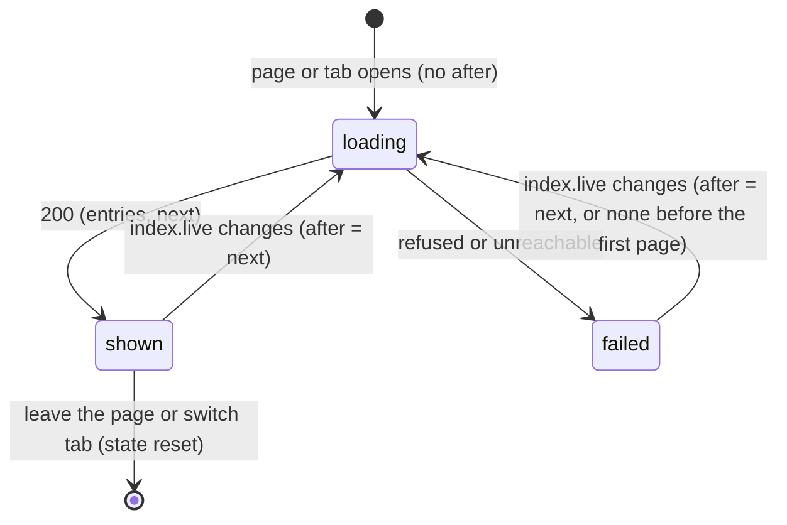

# F-015: Contract

Types from F-014 used here (`src/core/types.ts`): `AgentStatus`, `LiveWait`, `LiveWaitSpan`,
`LiveEdit`, `LiveEvent`, `LiveActivity`, `LiveAgent`, `LiveSession`, `TranscriptEntry`,
`TranscriptPage`. The viewer imports them with `import type`.

## Data structures

```ts
// viewer/src/lib/router.ts
export type Section =
  | "inbox"
  | "agents"
  | "overview"
  | "roadmap"
  | "features"
  | "decisions"
  | "questions"
  | "issues"
  | "activity"
  | "verification"
  | "knowledge";
// SECTIONS gains "agents" right after "inbox".
// Routes: #/agents                         → { section: "agents", id: null, tab: null }
//         #/agents/<claude-session>        → { section: "agents", id: "<claude-session>", tab: null }
//         #/agents/<claude-session>/<agent> → { section: "agents", id: "<claude-session>", tab: "<agent>" }

// viewer/src/lib/keys.ts
export const GOTO: Record<string, Section> = {
  i: "inbox",
  a: "agents",
  o: "overview",
  r: "roadmap",
  f: "features",
  d: "decisions",
  q: "questions",
  s: "issues",
  t: "activity",
  v: "verification",
  k: "knowledge",
};

// viewer/src/components/CommandPalette.tsx: SECTION_LABEL.agents = "Agents".
// viewer/src/components/AppShell.tsx: NAV gains { section: "agents", label: "Agents", icon: "agents" }
//   right after Inbox.
// viewer/src/components/Icon.tsx: ICONS.agents, from the handoff's Sidebar.dc.html (round caps):
//   <rect x="3" y="4.5" width="10" height="8.5" rx="2" /> <path d="M8 4.5V2.5" />
//   <circle cx="8" cy="2" r=".6" /> <path d="M6 8.2v.6M10 8.2v.6M6.5 11h3" />

// viewer/src/lib/status.ts (shared with F-016)
/** How an agent status looks: a mark class (always paired with a label) and its labels. */
export interface AgentLook {
  /** "az-run" (pulsing dot) | "az-wait" (diamond) | "az-g s-done" (check glyph). */
  mark: string;
  /** "Running" | "Waiting on you" | "Done". */
  label: string;
  /** "running" | "waiting" | "done", for tabs and trees. */
  short: string;
}
export const AGENT_LOOK: Record<AgentStatus, AgentLook>;
// running: { mark: "az-run", label: "Running", short: "running" }
// waiting: { mark: "az-wait", label: "Waiting on you", short: "waiting" }
// done:    { mark: "az-g s-done", label: "Done", short: "done" }

// viewer/src/data/agents.ts (shared with F-016)
/** One agent of a live session (its main agent or a subagent), flattened for lists and timelines. */
export interface AgentRow {
  /** "<claude_session>" for the main agent, "<claude_session>/<agent_id>" for a subagent. */
  key: string;
  claude_session: string;
  /** Null for the main agent. */
  agent_id: string | null;
  /** "Main session" for the main agent; else the subagent's agent_type, else "subagent". */
  name: string;
  /** The session's goal for the main agent; the subagent's description otherwise. */
  description: string | null;
  status: AgentStatus;
  waiting: LiveWait | null;
  current: LiveEvent | null;
  started_at: string;
  ended_at: string | null;
  last_seen_at: string;
  edits: LiveEdit[];
  waits: LiveWaitSpan[];
  /** The session's task and feature for the main agent; the subagent's own otherwise. */
  task: string | null;
  feature: string | null;
  transcript: boolean;
  /** href("agents", claude_session) or href("agents", claude_session, agent_id). */
  href: string;
}

/** F-014's IDLE_REASON, kept here because src/core/live-agents.ts isn't import-safe for the viewer. */
export const IDLE_REASON = "Waiting for your next prompt";

// viewer/src/data/transcript.ts
/** One agent's transcript as loaded so far. */
export interface TranscriptState {
  entries: TranscriptEntry[];
  /** The offset to request next; null until the first page arrives. */
  next: number | null;
  /** The first page didn't start at the beginning of the file. */
  skipped: boolean;
  /** The last request's failure, cleared by the next success. */
  error: string | null;
}
export const EMPTY_TRANSCRIPT: TranscriptState; // { entries: [], next: null, skipped: false, error: null }

export type TranscriptFetch =
  | { ok: true; page: TranscriptPage }
  | { ok: false; status: number; message: string };

// viewer/src/screens/agents/model.ts
export type AgentsFilter = "active" | "running" | "waiting" | "finished";

export interface AgentGroups {
  /** Sessions with status running, in index.live order. */
  running: LiveSession[];
  /** Sessions with status waiting, in index.live order. */
  waiting: LiveSession[];
  /** Done sessions whose sessionEnd is on the local day of `now`, latest end first. */
  finished: LiveSession[];
}

export interface StatusCount {
  sessions: number;
  subagents: number;
}

export interface Editor {
  /** AgentRow.key. */
  key: string;
  /** shortLabel(session), then " <name>" for a subagent: "…1201", "…1202 code-reviewer". */
  label: string;
  href: string;
}

export interface EditedFile {
  path: string;
  /** Distinct agents, in index.live order, main agent before its subagents. */
  editors: Editor[];
}

export interface Overlap {
  path: string;
  /** Sorted by ID. */
  features: [string, string];
}

export interface WaitingAgent {
  session: LiveSession;
  row: AgentRow;
  wait: LiveWait;
}

// viewer/src/screens/agents/transcript.ts
export type TranscriptKey = "prev" | "next" | "follow" | "back";
/** { "[": "prev", "]": "next", f: "follow", Escape: "back" }. */
export const TRANSCRIPT_KEYS: Record<string, TranscriptKey>;

export interface TouchedFile {
  path: string;
  how: "edited" | "read";
}

export interface NowLine {
  status: "running" | "waiting";
  /** "Waiting for test-runner…" | "Working…" | the wait reason. */
  text: string;
}

// viewer/src/screens/agents/AgentTranscript.tsx
export interface AgentTranscriptProps {
  index: Index;
  session: LiveSession;
  /** Null: the main agent's tab. */
  agentId: string | null;
  transcript: TranscriptState;
  now: number;
  /** "Following live": keep the newest entry in view. */
  follow: boolean;
  onFollow: (on: boolean) => void;
  /** "Show all tool output". */
  showAll: boolean;
  onShowAll: (on: boolean) => void;
}
```

CSS appended verbatim to `viewer/src/styles/azimuth.css` (lines 142–152 of the handoff's
`canvas-source/azimuth.css`, a blank line and comment included):

```css
/* Agents: run-state marks (always paired with a text label) */
@keyframes az-pulse { 0%, 100% { box-shadow: 0 0 0 0 rgba(250, 179, 135, 0.45); } 50% { box-shadow: 0 0 0 4px rgba(250, 179, 135, 0); } }
.az-run { flex: none; display: inline-block; width: 8px; height: 8px; border-radius: 50%; background: var(--st-active); animation: az-pulse 1.6s ease-in-out infinite; }
.az-wait { flex: none; display: inline-block; width: 8px; height: 8px; border-radius: 2px; background: var(--st-warning); transform: rotate(45deg); }
.az-stripe { background: repeating-linear-gradient(-45deg, rgba(249, 226, 175, 0.28) 0 4px, rgba(249, 226, 175, 0.08) 4px 8px); }
.az-tree { position: relative; padding-left: 28px; }
.az-tree::before { content: ""; position: absolute; left: 13px; top: 0; bottom: 18px; width: 1.5px; background: var(--hairline-strong); }
.az-twig { position: relative; }
.az-twig::before { content: ""; position: absolute; left: -15px; top: 18px; width: 12px; height: 1.5px; background: var(--hairline-strong); }
@media (prefers-reduced-motion: reduce) { .az-run { animation: none; } }
```

`viewer/src/styles/base.css` gains `.agent-status` (inline-flex, gap 8px) with the tone of each
status: `.agent-status.running` `var(--st-active)`, `.waiting` `var(--st-warning)`, `.done`
`var(--ink-subtle)`; and the sidebar's live count (`.nav .live-count`).

## Public signatures

```ts
// viewer/src/lib/format.ts (shared with F-016)
/**
 * A duration: "45s" under a minute; "4m 01s" under ten minutes ("5m" when the seconds are 0);
 * "25m" under an hour; "1h 05m" after ("2h" when the minutes are 0). Negative input → "0s".
 */
export function elapsed(ms: number): string;
/** "just now" under 5 s, "48s ago" under a minute, else ago(iso, now); "" for null. */
export function liveAgo(iso: string | null | undefined, now: number): string;
/** "12:01:04" in local time; "" for null. */
export function clockSeconds(iso: string | null | undefined): string;

// viewer/src/components/Status.tsx (shared with F-016)
/**
 * `<span class="agent-status <status>"><span class="<look.mark>" aria-hidden="true"></span>Label</span>`.
 * `short` uses look.short; `hideLabel` puts the label in a `.sr-only` span instead.
 */
export function AgentStatusMark(props: {
  status: AgentStatus;
  short?: boolean;
  hideLabel?: boolean;
}): ReactElement;

// viewer/src/data/agents.ts (shared with F-016; pure)
/** The main agent's row (from session.main), then one per subagent in `agents` order. */
export function agentRows(session: LiveSession): AgentRow[];
/** Sessions whose status isn't "done", in the given order. */
export function activeSessions(live: LiveSession[]): LiveSession[];
/** The SES ID, else the Claude Code session ID's first 8 characters. */
export function sessionLabel(session: LiveSession): string;
/** "…" + the SES ID after "SES-YYYYMMDD-" ("…1201"), else sessionLabel. */
export function shortLabel(session: LiveSession): string;
/** Null unless the session is done; then main.ended_at ?? ended_at ?? last_seen_at. */
export function sessionEnd(session: LiveSession): string | null;
/** Milliseconds from started_at to ended_at, or to `now` while it hasn't ended. */
export function agentDuration(row: Pick<AgentRow, "started_at" | "ended_at">, now: number): number;
/** A wait that isn't the idle main agent's (reason !== IDLE_REASON); false for null. */
export function isPermissionWait(wait: LiveWait | null): boolean;
/** "<tool> <file>" when the event has a file, else its summary. */
export function actionLabel(event: LiveEvent): string;

// viewer/src/data/IndexProvider.tsx
/** The `azimuth-token` meta tag's content; null without one or outside a browser (tests). */
export function pageToken(): string | null;

// viewer/src/data/transcript.ts
/** "/api/transcript/<encoded session>", then "?agent=<id>" and "after=<n>" when given. */
export function transcriptUrl(claudeSession: string, agent: string | null, after: number | null): string;
/**
 * GET transcriptUrl(…) with header x-azimuth-token. 200 → { ok: true, page }. Any other status →
 * { ok: false, status, message: body.message, else `${status} ${body.error}` }. A rejected fetch
 * → { ok: false, status: 0, message: "Couldn't reach azimuth view." }.
 */
export function fetchTranscript(
  req: { token: string; claudeSession: string; agent: string | null; after: number | null },
  fetchImpl?: typeof fetch,
): Promise<TranscriptFetch>;
/**
 * A successful page: appends its entries, except `result` entries, which update the loaded tool or
 * spawn entry with the same tool_use_id (status; diff, output and agent_id when not null) and are
 * dropped when there is none; next = page.next; skipped from the first page only; error null.
 * A failure: entries, next and skipped unchanged, error = message.
 */
export function applyTranscript(state: TranscriptState, result: TranscriptFetch): TranscriptState;
/**
 * The loaded transcript of one agent. Disabled: EMPTY_TRANSCRIPT and no request. Otherwise it
 * resets and requests the first page when the session or agent changes, and requests from `next`
 * whenever index.live changes, one request at a time (a change during a request queues one more).
 */
export function useTranscript(
  claudeSession: string,
  agentId: string | null,
  enabled: boolean,
): TranscriptState;

// viewer/src/lib/keys.ts
/**
 * Single-key shortcuts for one screen ("[", "]", "f", "Escape"…), keyed by KeyboardEvent.key.
 * Ignored while typing, with a modifier, right after a `g`, while an overlay has the keyboard,
 * or when `enabled` is false. The latest handlers are used on each key press.
 */
export function useScreenKeys(handlers: Record<string, () => void>, enabled?: boolean): void;

// viewer/src/screens/agents/model.ts (pure)
export function agentGroups(live: LiveSession[], now: number): AgentGroups;
/** active = running + waiting sessions; the others count their group. */
export function filterCounts(groups: AgentGroups): Record<AgentsFilter, number>;
/** active: every group; running, waiting, finished: that group only (the others empty). */
export function shownGroups(groups: AgentGroups, filter: AgentsFilter): AgentGroups;
/** Sessions that aren't done and the number of their subagents (all statuses). */
export function headerCounts(live: LiveSession[]): StatusCount;
/**
 * running/waiting: sessions and subagents (in any session) with that status; doneToday: the
 * finished group and subagents that are done with ended_at on the local day of `now`.
 */
export function rightNow(
  live: LiveSession[],
  now: number,
): { running: StatusCount; waiting: StatusCount; doneToday: StatusCount };
/** "2 sessions · 2 subagents", "1 session", "3 subagents"; "None" when both are 0. */
export function countLine(count: StatusCount): string;
/**
 * Files in the edits of agents that aren't done, first seen first, each with its editors;
 * conflicts: those with two or more editors whose path matches no `sharedFiles` glob.
 */
export function editedFiles(
  live: LiveSession[],
  sharedFiles: string[],
): { files: EditedFile[]; conflicts: EditedFile[] };
/** Pairs of derived.file_conflicts whose features are both in flight in a session that isn't done, sorted by path then features. */
export function plannedOverlaps(index: Index): Overlap[];
/** Open permission waits of every agent of every session that isn't done, oldest first. */
export function needsYou(live: LiveSession[]): WaitingAgent[];
/** "<goal or No goal recorded>[ · N subagents][ · left a handoff]" (handoff: the SES's non-blank handoff). */
export function finishedSummary(index: Index, session: LiveSession): string;
/** Chips and title for "Working on": features (else [feature]), task, and the task's title, else the only feature's title. */
export function workingOn(
  index: Index,
  session: Pick<LiveSession, "features" | "feature" | "task">,
): { features: string[]; task: string | null; title: string | null };

// viewer/src/screens/agents/transcript.ts (pure)
/** The row `delta` steps from the current tab (agent ID, null = main); null past either end. */
export function stepAgent(rows: AgentRow[], current: string | null, delta: -1 | 1): AgentRow | null;
/** Tool and spawn entries. */
export function toolCalls(entries: TranscriptEntry[]): number;
/** Edit, MultiEdit, Write, NotebookEdit targets as "edited", then Read targets as "read"; edited wins; each first seen first. */
export function touchedFiles(entries: TranscriptEntry[]): TouchedFile[];
/** Tool entries start open when they have a diff or their status isn't "ok"; other entries always show. */
export function startsOpen(entry: TranscriptEntry): boolean;
/** Null when the agent is done; its wait reason while waiting; else "Waiting for <type>…" after a running spawn, or "Working…". */
export function nowLine(row: AgentRow, entries: TranscriptEntry[]): NowLine | null;
/** "@@…" → "hunk", "+…" → "add", "-…" → "del", otherwise null. */
export function diffLineClass(line: string): "hunk" | "add" | "del" | null;

// Screens and components (React)
// viewer/src/screens/Agents.tsx
export function AgentsScreen(props: { route: Route }): ReactElement | null;
// viewer/src/screens/agents/AgentCard.tsx
export function AgentCard(props: { index: Index; session: LiveSession; now: number; selected: boolean }): ReactElement;
export function FinishedRow(props: { index: Index; session: LiveSession; selected: boolean }): ReactElement;
// viewer/src/screens/agents/AgentsAside.tsx
export function AgentsAside(props: { index: Index; now: number }): ReactElement;
// viewer/src/screens/agents/AgentTranscript.tsx
/** Empty states (feature.md order), then AgentTranscript with useTranscript, keys and local follow/showAll state. */
export function AgentTranscriptScreen(props: { claudeSession: string; agentId: string | null }): ReactElement;
export function AgentTranscript(props: AgentTranscriptProps): ReactElement;
// viewer/src/screens/agents/TranscriptEntries.tsx
export function TranscriptEntries(props: {
  session: LiveSession;
  entries: TranscriptEntry[];
  now: number;
  showAll: boolean;
  nowLine: NowLine | null;
}): ReactElement;
// viewer/src/screens/agents/TranscriptAside.tsx
export function TranscriptAside(props: {
  index: Index;
  session: LiveSession;
  agentId: string | null;
  entries: TranscriptEntry[];
  now: number;
}): ReactElement;
```

Routing (`viewer/src/App.tsx`, `Screen`):

```text
case "agents": route.id ? <AgentTranscriptScreen claudeSession={route.id} agentId={route.tab} />
                        : <AgentsScreen route={route} />
```

Request (F-014's route, unchanged):

```text
GET /api/transcript/c1201?agent=a1&after=48213
x-azimuth-token: <the page's token>
```

Texts the screens show (exact):

| Where | Text |
| --- | --- |
| Agents header | `3 sessions · 4 subagents`, `Live · 12:05` |
| Filter | `Active 3`, `Running 2`, `Waiting on you 1`, `Finished today 2` |
| Card meta | `<SES or short ID>`, skill tag, `started 12:01 · 3m 56s` |
| Card | `Working on`, `Transcript`, `▸ <action> +4 −1 · 48s ago`, `<reason> · since 12:00` |
| Side panel | `Right now`, `Files being edited`, `No two agents are editing the same file`, `Planned overlaps`, `<A> and <B> both plan changes to <path>`, `No in-flight features plan changes to the same file`, `Needs you`, `Answer it in the Claude Code terminal running this session`, `Nothing is waiting on you` |
| Empty | `No agent is working right now` / `Sessions show up here while Claude Code works.`; export: `Agents are only shown in the live viewer` |
| Transcript | `started 12:01:04 · 3m 56s · 7 tool calls`, `Copy session ID`, `Following live` / `Follow live`, `Live · new output appears at the bottom` + `Pause` / `Paused` + `Resume`, `Show all tool output`, `Spawned subagent`, `Open its transcript →`, `now`, `running 42s` |
| Transcript side panel | `Agents in this session`, `Covers`, `Files`, `Commits`, `None yet in this session`, `No task named` |
| Transcript notes | `Earlier entries aren't shown: this view starts in the transcript's last 512 KiB.`, `Couldn't load the transcript: <message>`, `Loading the transcript…` |
| Transcript empty | `Transcripts are only available in the live viewer`; `This is a read-only snapshot. Run azimuth view to follow agents live.`; `No transcript was recorded for this agent.`; `No live session <id>`; `No subagent <id> in this session` |

## Errors

No new error variants and no new HTTP routes. Transcript request failures are shown, not thrown:

| Case | `TranscriptFetch` | Shown |
| --- | --- | --- |
| 403 `{error: "token"}` (no message) | `{ok: false, status: 403, message: "403 token"}` | `Couldn't load the transcript: 403 token` |
| 404 / 400 / 403 with a message | `{ok: false, status, message}` | `Couldn't load the transcript: <message>` |
| Network failure | `{ok: false, status: 0, message: "Couldn't reach azimuth view."}` | `Couldn't load the transcript: Couldn't reach azimuth view.` |

Entries already loaded stay on screen; the next `live` event retries from the same `next`.

## State transitions

The transcript view's loading:



## Test fixture

`test/fixtures/live/agents.ts` (TypeScript, like `test/fixtures/hookline/expected-index.ts`),
shaped by F-014's types. Times are 2026-10-18 UTC; tests set `TZ=UTC` and render with
`now = AGENTS_NOW`, against `expectedIndex` (Hookline: F-005 in progress with T-005.4
"Exhaustion & policy validation (red → green)" covering S-005.2.1 (failing) and S-005.2.2
(untested); F-005 and F-007 conflict on `src/worker/deliver.ts`; F-007 "Delivery attempt log" has
no tasks; F-010 "Prometheus metrics"; SES-20261018-1100 has a handoff and commits 9f3c2e1, 6c0e3d8,
a41f2b9; SES-20261018-0930 has a handoff; SES-20261018-1201 has no commits).

```ts
export const AGENTS_NOW: number; // Date.parse("2026-10-18T12:05:00Z")
export function liveEvent(over: Partial<LiveEvent>): LiveEvent;
export function liveAgent(over: Partial<LiveAgent>): LiveAgent;
export function liveSession(over: Partial<LiveSession>): LiveSession;
/** A fresh copy of the six sessions below, in this order. */
export function agentsLive(): LiveSession[];
/** expectedIndex with `live` replaced (structuredClone), plus overrides. */
export function indexWithLive(live: LiveSession[], over?: Partial<Index>): Index;
export const transcriptPage1: TranscriptPage;
export const transcriptPage2: TranscriptPage;
```

| Session (claude_session) | ses · skill · goal | Status | Started → end | Work | Main agent's current; edits | Subagents |
| --- | --- | --- | --- | --- | --- | --- |
| `c1201` | SES-20261018-1201 · build · "Turn S-005.2.1 green: implement retry exhaustion" | running | 12:01:04 | feature F-005, task T-005.4, features [F-005] | Edit `src/retry/policy.ts` at 12:04:12, +4 −1; the same edit. Session `current`: a1's Bash at 12:04:50 | `a1` test-runner "Re-run policy.test.ts after each edit", running from 12:04:20, current Bash "pnpm vitest run src/retry/policy.test.ts" (no file); `a2` explorer "Find every caller of decideRetry()", done 12:01:20 → 12:02:32, current Grep `Searched for "decideRetry("` |
| `c1202` | SES-20261018-1202 · build · "Fix the two lint errors, then re-verify F-007" | running | 12:02:00 | F-007, T-007.4, [F-007] | Edit `src/api/attempts.ts` at 12:04:39, sizes null; the same edit | `a3` code-reviewer "Check the attempts.ts diff for other unawaited promises", running from 12:04:08, current Read `src/api/attempts.ts` at 12:04:30 |
| `c1140` | SES-20261018-1140 · spec · "Write the F-010 spec" | waiting, "Permission prompt: WebFetch prometheus.io" since 12:00:00 (main agent too) | 11:40:00 | F-010, no task, [F-010] | Read `docs/metrics.md` at 11:59:30; no edits | `a4` researcher "Survey current log fields and counters in src/", done 11:42:00 → 11:50:00 |
| `c1100` | SES-20261018-1100 · build · "Build F-005 tasks T-005.2 to T-005.4" | done | 11:00:00 → 11:58:00 (`ended_at` 11:58:00) | F-005, T-005.4, [] | – | `a5` test-runner done 11:10 → 11:30; `a6` explorer done 11:20 → 11:45 |
| `c0930` | SES-20261018-0930 · spec · "Write the F-008 spec" | done | 09:30:00 → main 10:25:00 (`ended_at` null) | F-008, no task, [] | – | none |
| `c1430` | SES-20261017-1430 · build · "Build F-007" | done | 2026-10-17 14:30 → 16:45 | F-007 | – | none |

Every agent has `transcript: true`. `transcriptPage1` (`c1201`, main agent; `next` 48213,
`skipped` false):

| # | Entry |
| --- | --- |
| 1 | message user 12:01:04 "Build T-005.4" |
| 2 | message assistant 12:01:09 "Picking up T-005.4 from the handoff." |
| 3 | tool `toolu_read` Read `src/retry/policy.test.ts`, ok, no diff or output, 12:01:12 |
| 4 | spawn `toolu_explore` "Find every caller of decideRetry()", explorer, agent `a2`, ok, output ["Found 1 caller: src/worker/deliver.ts"], 12:01:20 |
| 5 | tool `toolu_edit` Edit `src/retry/policy.ts`, ok, diff ["@@ -12,2 +12,5 @@", "-  if (attempt > policy.maxAttempts) return exhausted;", "+  if (attempt >= policy.maxAttempts) {", "+    return exhausted;", "+  }", "+  // retryable"], +4 −1, 12:04:12 |
| 6 | tool `toolu_test` Bash `pnpm vitest run src/retry/policy.test.ts` (summary "Run the policy tests"), ok, output ["✓ S-005.2.1 marks delivery exhausted"], 12:04:14 |
| 7 | tool `toolu_lint` Bash `pnpm lint`, error, output ["src/retry/policy.ts:14 error no-unused-vars"], 12:04:16 |
| 8 | tool `toolu_build` Bash `pnpm build`, running, 12:04:18 |
| 9 | spawn `toolu_runner` "Re-run policy.test.ts after each edit", test-runner, agent `a1`, running, 12:04:20 |

`transcriptPage2` (`next` 50112, `skipped` false): a `result` for `toolu_runner` (ok, output
["3 passed"], agent `a1`, 12:05:10), then message assistant 12:05:12 "All three scenarios pass."
