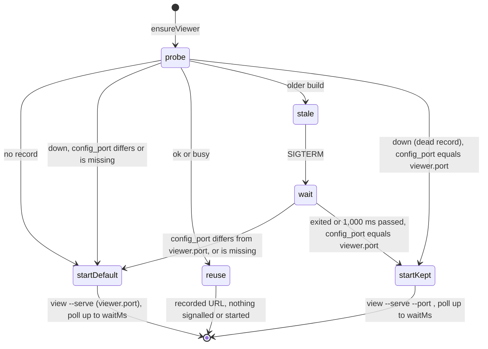

# F-024: Contract

## Data structures

```ts
// src/core/next.ts (new type)

/** Ready tasks of several in-progress features, grouped like a feature's own (TaskGroup). */
export interface CrossFeatureGroups {
  /** The features whose ready tasks were grouped, in the order their tasks were taken. */
  features: Id[];
  /** parallelGroups over those tasks, with index.project.shared_files. */
  groups: TaskGroup[];
}

// src/server/registry.ts (one new optional field)

export interface ViewerRecord {
  pid: number;
  port: number;
  instance: string;
  version: string;
  root: string;
  started_at: string;
  /**
   * config.yaml's viewer.port when this server started (loadConfig, defaults when the file is
   * missing), whatever port it was given with --port. Absent in records written before 0.3.
   */
  config_port?: number;
}

// viewer/src/screens/issues/history.ts (one new member of the union)

export type HistoryEntry =
  | { kind: "created"; at: ISODate; by: Id | "you" | "agent" }
  | { kind: "status"; at: ISODateTime; actor: Actor; from: string; to: string; reason: string }
  /** A Status notes bullet `<stamp> · <actor> · <text>` that isn't a move (azimuth log's form). */
  | { kind: "logged"; at: ISODateTime; actor: Actor; text: string }
  | { kind: "commit"; at: ISODateTime; sha: Sha; subject: string }
  | { kind: "note"; at: null; text: string };
```

## Public signatures

```ts
// src/core/transitions.ts

/**
 * Adds a note (anyone) or a review comment (you) to a feature's log, or a note to an issue.
 *
 * For a feature, story, scenario or task: unchanged. One log.md entry in the feature's log, the
 * body prefixed with `<ref>: ` unless ref is the feature; message `<F-ID>: <type> added`.
 *
 * For an issue (BUG-, DEBT-, RISK-; idKind "issue") and type "note": inside withLock, reads the
 * issue from analyzeProject's model and writes its file with
 * addStatusNote(text, `${stamp(now)} · ${opts.actor} · ${body}`): one bullet in the body's
 * "## Status notes" section (created at the end of the body when missing; further lines of the
 * body indented two spaces). Returns { ref, from: null, to: null, changed: [<issue file>],
 * auto: false, message: `${ref}: note added` }.
 *
 * Checks, in order: blank body; "review" by the agent; "review" on an issue; a ref that is
 * neither an issue nor maps to a feature (featureOf); an unknown issue or feature (see Errors).
 */
export function addLogEntry(
  root: string,
  ref: string,
  type: "note" | "review",
  body: string,
  opts: Who,
): Result;

/**
 * Unchanged signature and success path. The status refusal for a verifying feature gains a
 * sentence (see Errors); every other refusal keeps its text.
 */
export function reapproveFeature(root: string, id: string, opts: MoveOptions): Result;

// src/core/next.ts

/**
 * The groups of the ready tasks of every in-progress feature that no open blocking question
 * holds (blocked_by of kind "question"), taking the features with at least one ready task by
 * priority, then ID (byPriority, nextWork's order), and each feature's tasks in readyTasks order
 * (in-progress first, then plan order), in one parallelGroups call with
 * index.project.shared_files. Null unless at least two features have a ready task.
 */
export function crossFeatureGroups(index: Index): CrossFeatureGroups | null;

// src/cli/commands/read.ts (module-private)

/** Group lines printed after `Across …:`; more groups are counted on one line. */
const MAX_CROSS_GROUP_LINES = 6;

/**
 * `Across <features joined by ", ">:`, then groupLine(g) for the first MAX_CROSS_GROUP_LINES
 * groups, then `… and <n> more` when n further groups exist.
 */
function crossFeatureLines(cross: CrossFeatureGroups): string[];

// src/server/autostart.ts

/**
 * Resolves true as soon as `alive(pid)` returns false, checking at once and then every 50 ms;
 * resolves false once `timeoutMs` has passed with the process still running. Never throws.
 */
export function waitForExit(
  pid: number,
  timeoutMs: number,
  alive?: (pid: number) => boolean, // default: processAlive (src/core/live.ts)
): Promise<boolean>;

/**
 * Unchanged signature. Reuses a healthy or busy viewer as today. Otherwise, when a record
 * exists: a stale viewer gets SIGTERM, then waitForExit(pid, 1_000); a down one gets nothing.
 * The detached server it starts (when claimStart succeeds) runs
 * `view --serve --root <root> --port <recorded port>` when a record exists and its config_port
 * equals loadConfig(root).config.viewer.port, and `view --serve --root <root>` (viewer.port from
 * config.yaml) otherwise: no record, a different config_port, or none. Then it waits up to
 * `waitMs` for a healthy new record, as today; the exit wait isn't counted in `waitMs`.
 */
export function ensureViewer(root: string, waitMs?: number): Promise<string | null>;

// src/server/server.ts: unchanged signature. With `register: true`, the record it writes gains
// `config_port: loadConfig(opts.root).config.viewer.port`; every other field is as today.
export function startServer(opts: ServerOptions): Promise<RunningServer>;

// viewer/src/screens/issues/history.ts: unchanged signature. A Status notes bullet matching
// today's move pattern is a "status" entry; else one matching /^(\S+) · (you|agent) · (.+)$/
// whose first part parses as a time (Date.parse) is a "logged" entry; else a "note" entry with
// at: null, as written. Dated entries ("logged" included) sort by time, ties in today's order.
export function issueHistory(issue: Issue, commits: Commit[]): HistoryEntry[];

// viewer/src/screens/issues/IssueHistory.tsx: a "logged" entry's row text is
// `<Who by={actor} /> noted: {text}` ("You noted: …", "An agent noted: …"), its date column
// shortDate(at), its class `ip-history-row logged`.
```

### `azimuth log`

```text
azimuth log <ID> "<message>" [--review]
```

The usage line is unchanged. The summary becomes:
`Add a progress note to a feature's log or an issue's Status notes (or, as you, a change request to a feature)`.

On success stdout is the result's message (`F-001: note added`, `F-001: review added`,
`BUG-0001: note added`), or the Result with `--json`; exit 0. The session's `touched` gains the
issue ID alone (the existing `touch` helper). A refusal prints `✗ <message>` on stderr, exits 1
and writes nothing.

An issue file after `azimuth log BUG-0001 "Reproduced with a BOM"` at 2026-10-20T09:00:00Z, by
the agent, when the issue has no Status notes yet:

```markdown
---
id: BUG-0001
…
---
## Repro
Run it.

## Status notes
- 2026-10-20T09:00:00Z · agent · Reproduced with a BOM
```

### `azimuth next` without an ID

The items print as today. When `crossFeatureGroups(index)` isn't null, its lines follow them:

```text
T-001.1 azimuth move T-001.1 in-progress
  F-001
T-002.1 azimuth move T-002.1 in-progress
  F-002
T-002.2 azimuth move T-002.2 in-progress
  F-002
Across F-001, F-002:
Can run together: T-001.1, T-002.1
On its own: T-002.2
```

With more than six groups, the sixth group line is followed by `… and <n> more`. `--json`
prints the array of items, as today; `next F-NNN` and its `--json` are unchanged.

## Errors

`addLogEntry` (`AzimuthError`, nothing written; exit 1 on the command line):

| Case                                              | Code        | Message                                                                                      |
| ------------------------------------------------- | ----------- | -------------------------------------------------------------------------------------------- |
| blank body (unchanged)                            | `invalid`   | `A log entry needs some text.`                                                               |
| `review` by the agent (unchanged)                 | `policy`    | `Only the user requests changes.`                                                            |
| `review` on an issue                              | `invalid`   | `Change requests (--review) go to a feature; BUG-0001 is an issue.`                          |
| any other ID (Q-, ADR-, M-, SES-, R-, malformed)  | `invalid`   | `Q-0001 is not a feature, story, scenario, task or issue.`                                   |
| unknown issue                                     | `not-found` | `BUG-0009 does not exist.`                                                                   |
| unknown feature (unchanged)                       | `not-found` | `F-009 does not exist (or has errors that keep it out of the index; run \`azimuth check\`).` |

`reapproveFeature`'s status refusal (`invalid`):

| Status                                       | Message                                                                                                                                                   |
| -------------------------------------------- | --------------------------------------------------------------------------------------------------------------------------------------------------------- |
| verifying                                    | `F-001 is verifying; only approved or in-progress features can be re-approved. The done gate doesn't check the approval, so a spec fix during close-out needs no reapproval.` |
| idea, draft, done, deferred, cancelled or superseded (unchanged) | `F-001 is done; only approved or in-progress features can be re-approved.` (the status as it is) |

`crossFeatureGroups` and `waitForExit` don't throw. `ensureViewer` keeps its failure modes: it
returns null when no healthy viewer came up within `waitMs`; a failed spawn is the server's
(`Ports … are all in use …` from the server's scan, visible with `azimuth view`).

## State transitions


