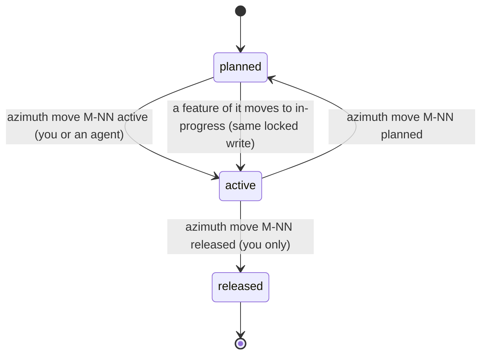

# F-026: Contract

## Data structures

```ts
// src/core/milestone-page.ts (new module; no Node imports)

/** One feature line of a milestone page. */
export interface MilestonePageFeature {
  id: Id;
  priority: Priority;
  title: string;
}

/** The features of one status, by priority then ID (byPriority). */
export interface MilestonePageGroup {
  status: FeatureStatus;
  /** False for cancelled and superseded, which milestoneProgress doesn't count. */
  counted: boolean;
  features: MilestonePageFeature[];
}

/**
 * What `azimuth show M-NN` prints. F-028 adds its commits as one more field (and its release
 * and commits sections as two more section functions in formatMilestonePage).
 */
export interface MilestonePage {
  /** The index's milestone, with its features and progress. */
  milestone: Milestone;
  /** Non-empty groups in PAGE_STATUS_ORDER. */
  groups: MilestonePageGroup[];
  /** Counted features that aren't done (deferred included), in the groups' order. */
  blocking: Id[];
  /** milestoneReady(milestone). */
  ready: boolean;
  /** milestoneStartedWhilePlanned(milestone). */
  started_while_planned: boolean;
}

/**
 * The groups' order: work in flight, what waits, what is finished, what doesn't count.
 * ["in-progress", "verifying", "approved", "draft", "idea", "deferred", "done", "cancelled",
 *  "superseded"]
 */
export const PAGE_STATUS_ORDER: readonly FeatureStatus[];
```

## Public signatures

```ts
// src/core/flows.ts (new, next to milestoneReady)

/** Feature statuses that mean work on the feature has started. */
export const STARTED_STATUSES: readonly FeatureStatus[]; // ["in-progress", "verifying", "done"]

/** Counted features (progress.by_status) whose status is in STARTED_STATUSES. */
export function startedCount(m: Pick<Milestone, "progress">): number;

/**
 * A planned milestone with startedCount ≥ 1 that milestoneReady doesn't accept: its work has
 * started but its status says it hasn't. A planned milestone whose features are all done is
 * ready instead, never both.
 */
export function milestoneStartedWhilePlanned(m: Pick<Milestone, "status" | "progress">): boolean;

// src/core/validate.ts (module-private, changed)

/**
 * For each milestone, in model order, with milestoneProgress spread in: W-MILESTONE-READY when
 * milestoneReady accepts it (F-023, unchanged), else W-MILESTONE-PLANNED when
 * milestoneStartedWhilePlanned does (see Errors), else nothing.
 */
function milestoneProblems(model: Model): Problem[];

// src/core/next.ts (only change: the existing comparator is exported for the page)

/** Unchanged comparator (priority, then ID). */
export const byPriority: (a: Feature, b: Feature) => number;

// src/core/transitions.ts

/**
 * Unchanged signature, refusals and writes, except: when `to` is "in-progress" and every check
 * has passed, milestoneActivation(root, model, f) runs inside the same withLock; when it returns
 * a write, that write is saved in the same save() call after feature.md and log.md, `changed`
 * gains the milestone file, and the message gains ` (<M-ID>: planned → active)`:
 * `F-001: approved → in-progress (M-01: planned → active)`. `auto` is unchanged (false).
 */
export function moveFeature(root: string, id: string, toRaw: string, opts: MoveOptions): Result;

/**
 * Module-private. The milestone named by f.milestone, from model.milestones, when it exists and
 * is planned: its file with updateFrontmatter(read(root, m.file), { status: "active" }) and the
 * note `<M-ID>: planned → active`. Null for a feature without a milestone, a milestone ID with
 * no record, or an active or released milestone. Separate from moveMilestone, which neither
 * F-026 nor F-028 changes (F-028 adds releaseMilestone in src/core/release.ts).
 */
function milestoneActivation(
  root: string,
  model: Model,
  f: FeatureEntity,
): { write: Write; note: string } | null;

// src/core/milestone-page.ts

/**
 * The page of the index's milestone `id`, or null when there is none. Groups the index's
 * features whose `milestone` is `id` by status in PAGE_STATUS_ORDER, leaving out empty groups,
 * each sorted with byPriority. Pure: no I/O, no clock.
 */
export function milestonePage(index: Index, id: string): MilestonePage | null;

/**
 * The page as text, without a trailing newline: the non-empty results of the module-private
 * section functions, in order, joined by one blank line ("\n\n").
 */
export function formatMilestonePage(page: MilestonePage): string;

// Module-private sections of formatMilestonePage, in this order:
type Section = (page: MilestonePage) => string[];
const SECTIONS: Section[]; // [headerSection, groupsSection, readinessSection]

/**
 * `<M-ID> <title>`;
 * `Status: <status>` + (status released and released_at set ? ` <released_at>` : "")
 *   + (target ? `, target <target>` : "");
 * `Goal: <goal>` unless goal.trim() is empty;
 * `Progress: <progress.done>/<progress.total> done`.
 */
function headerSection(page: MilestonePage): string[];

/**
 * Per group: `<status> (<n>)`, or `<status> (<n>, not counted)` when !counted, then
 * `  <F-ID> <priority> <title>` per feature. Empty when there are no groups.
 */
function groupsSection(page: MilestonePage): string[];

/**
 * Empty unless the milestone is planned or active. Else one of
 * `No features count toward it yet.` (progress.total 0),
 * `Ready: every feature is done; ask the user to release <M-ID>.` (ready),
 * `Keeping it from being ready: <blocking joined by ", ">`;
 * then, when started_while_planned,
 * `Work has started on its features but it is still planned: azimuth move <M-ID> active`.
 */
function readinessSection(page: MilestonePage): string[];

// src/cli/commands/read.ts: `show` keeps its usage, options and --json branch. Without --json
// and --brief, a milestone ID (idKind "milestone") prints formatMilestonePage(milestonePage(…)),
// and an unknown one throws UsageError(`${id} not found.`) as today. Every other case prints
// showBrief as today.
```

### `azimuth show M-NN`

```text
azimuth show <ID> [--brief | --json]
```

The usage line is unchanged. The page of S-026.3.2:

```text
M-01 First
Status: active, target 2026-11-15
Goal: Ship the login flow.
Progress: 1/5 done

in-progress (2)
  F-006 P0 Reset password
  F-001 P1 Login
approved (1)
  F-002 P2 Logout
deferred (1)
  F-004 P3 Export
done (1)
  F-003 P2 Signup
cancelled (1, not counted)
  F-005 P2 Import

Keeping it from being ready: F-006, F-001, F-002, F-004
```

`--brief` prints showBrief's line (`M-01 active First: 1/5 done, target 2026-11-15`), and
`--json` the index's milestone, as today. Exit 0; an unknown ID exits 2.

### `azimuth move F-NNN in-progress`

On success, stdout is the result's message: `F-001: approved → in-progress` as today, or
`F-001: approved → in-progress (M-01: planned → active)` when the feature's milestone was
planned. `--json` prints the Result (its `changed` lists the milestone file too). The viewer's
`move` action returns the same message, which its toast shows as the title.

## Errors

`moveFeature` keeps every refusal; each one, including a gate failure and a stale `expect`,
writes nothing, the milestone file included.

New `validate` problem:

| Code                  | When                                          | File                 | Line | Ref              | Message                                                                                                                        |
| --------------------- | --------------------------------------------- | -------------------- | ---- | ---------------- | ------------------------------------------------------------------------------------------------------------------------------ |
| `W-MILESTONE-PLANNED` | `milestoneStartedWhilePlanned` accepts it     | the milestone's file | null | the milestone ID | `` <M-ID> is still planned with work started on <startedCount> of its <progress.total> features; move it to active (`azimuth move <M-ID> active`). `` |

Severity `warning`; not in `HINT_CODES`. `W-MILESTONE-READY` keeps F-023's text and takes
precedence.

`milestonePage` returns null for an unknown ID and doesn't throw; `show` then throws
`UsageError("M-09 not found.")` (stderr `M-09 not found.` and the usage line, exit 2).
`startedCount` and `milestoneStartedWhilePlanned` don't throw.

## State transitions


