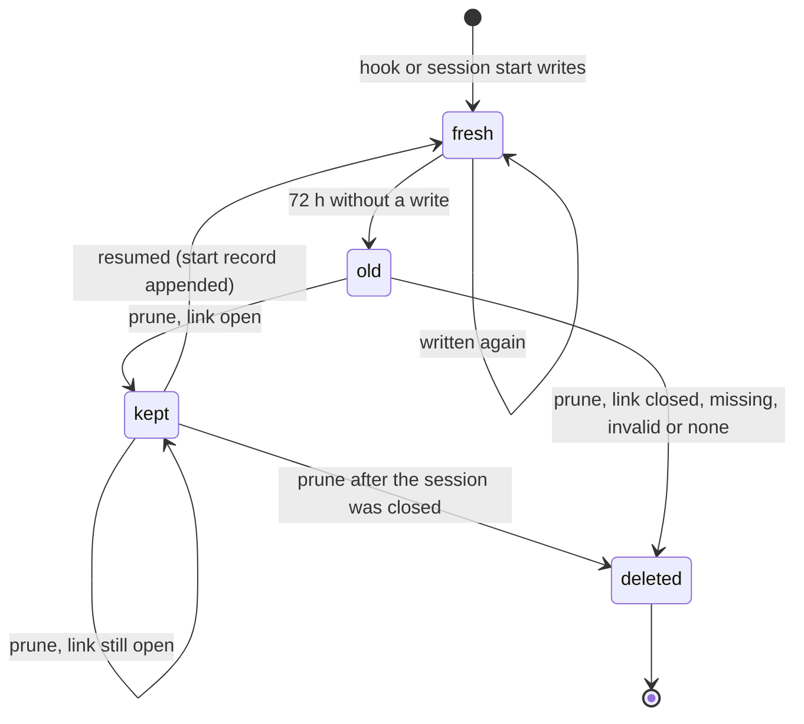

# F-027: Contract

## Data structures

```ts
// src/core/session.ts (new types)

/**
 * The state of the session the CLI would use, read from its own file:
 * open: the file parses and ended_at is null;
 * closed: ended_at is set;
 * missing: .azimuth/sessions/<id>.md doesn't exist;
 * invalid: the file exists but its frontmatter doesn't parse (parseSession gives no entity).
 */
export type LinkState = "open" | "closed" | "missing" | "invalid";

export interface LinkedSession {
  /** What currentSession returned: AZIMUTH_SESSION, else the Claude Code session's link. */
  id: string;
  state: LinkState;
  /** The file's ended_at when state is "closed"; null otherwise. */
  ended_at: ISODateTime | null;
}

// src/hooks/handlers.ts (one new optional field)

export interface HookEnv {
  CLAUDE_PROJECT_DIR?: string;
  CLAUDE_ENV_FILE?: string;
  AZIMUTH_NO_VIEWER?: string;
  CLAUDE_CODE_REMOTE?: string;
  CLAUDE_PID?: string;
  /** The same override the CLI reads; the start hook passes it to linkedSession. */
  AZIMUTH_SESSION?: string;
}
```

## Public signatures

```ts
// src/core/session.ts

/**
 * The session `azimuth session note`, `handoff` and `close` use without --id, with its state:
 * currentSession(root, env), then the session's own file (readSession, no loadProject).
 * Null when currentSession returns null. Never throws for a missing or unparseable file.
 */
export function linkedSession(root: string, env: SessionEnv): LinkedSession | null;

/**
 * Whether a Claude Code session's own link names an open Azimuth session:
 * linkedSession(root, { AZIMUTH_CLAUDE_SESSION: claudeSession })?.state === "open".
 * AZIMUTH_SESSION plays no part.
 */
export function linkOpen(root: string, claudeSession: string): boolean;

// Unchanged: currentSession, sessionOfClaude, claudeSessionFromEnv, startSession, appendNote,
// writeHandoff, closeSession, closeStaleSessions, sessionStale.

// src/core/live.ts

/**
 * Deletes live files untouched for more than 72 hours, as before, except a live log
 * `<c>.jsonl` or sidecar `<c>.meta.json` for which keep(c) returns true; c is the file name
 * without its suffix. keep is asked only for those old files, inside the per-file try, and a
 * kept file isn't written or touched. Without keep, nothing is kept (today's behaviour).
 */
export function pruneLive(
  root: string,
  now?: Date,
  keep?: (claudeSession: string) => boolean,
): void;

// src/hooks/handlers.ts

/**
 * Unchanged signature. Calls pruneLive(root, now, (c) => linkOpen(root, c)) where it calls
 * pruneLive today. For source "resume", "clear" and "compact", computes
 * linkedSession(root, { AZIMUTH_SESSION: ctx.env.AZIMUTH_SESSION, AZIMUTH_CLAUDE_SESSION: id })
 * after recording the start, and prints sessionLines(...) of it:
 * - compact: each line prefixed "- ", right after "Azimuth (context restored after
 *   compaction):", in place of today's "- You are in Azimuth session <ses>." bullet;
 * - resume and clear: after the status brief and the last handoff, behind a blank line, as the
 *   last two lines of the context.
 * Any other source (startup, none) prints the context it prints today.
 */
export async function sessionStart(input: HookInput, ctx: HookContext): Promise<HookOutput>;

/** Module-private: the two lines for a linked session's state, or for no link (null). */
function sessionLines(linked: LinkedSession | null): [string, string];
```

### The session lines

`<ID>` is `linked.id`, `<ended_at>` is `linked.ended_at`.

| State   | First line                                                                    | Second line                                                                                                                              |
| ------- | ----------------------------------------------------------------------------- | ---------------------------------------------------------------------------------------------------------------------------------------- |
| open    | `You are in Azimuth session <ID>.`                                            | `` `azimuth session note` and `azimuth session handoff` write to it, and `azimuth session start` adds its goal to it. ``                 |
| closed  | `This conversation's Azimuth session <ID> was closed at <ended_at>.`          | `` `azimuth session start` opens a new one; until then `azimuth session note` and `azimuth session handoff` still write to <ID>. ``      |
| missing | `This conversation's Azimuth session <ID> has no file in .azimuth/sessions/.` | `` `azimuth session start` opens a new one; until then `azimuth session note` and `azimuth session handoff` fail with "<ID> does not exist." `` |
| invalid | ``This conversation's Azimuth session <ID> has errors (run `azimuth check`).`` | `` `azimuth session start` opens a new one; until then `azimuth session note` and `azimuth session handoff` still write to <ID>. ``      |
| none    | `No Azimuth session in this conversation yet.`                                | ``Run `azimuth session start --skill <skill> --goal "<goal>"` before `azimuth session note` or `azimuth session handoff`.``               |

A resumed conversation's context, its session open (the brief and handoff as today):

```text
This repository is managed with Azimuth (protocol: .azimuth/PROTOCOL.md). …

<status brief>

Last handoff (SES-20261020-1343, release: Release M-02):
…

You are in Azimuth session SES-20261020-1343.
`azimuth session note` and `azimuth session handoff` write to it, and `azimuth session start` adds its goal to it.
```

A compaction note, the session closed:

```text
Azimuth (context restored after compaction):
- This conversation's Azimuth session SES-20261020-1343 was closed at 2026-10-21T10:00:00Z.
- `azimuth session start` opens a new one; until then `azimuth session note` and `azimuth session handoff` still write to SES-20261020-1343.
- Run `azimuth status --brief` to reload the project state before continuing.
```

## Errors

None new. `linkedSession` and `linkOpen` don't throw for a missing or unparseable session file,
and `pruneLive` and the hooks never throw, as today. The CLI's refusals are unchanged:

| Case (no --id)                     | Code        | Message                                                                     |
| ---------------------------------- | ----------- | --------------------------------------------------------------------------- |
| no link (`currentSession` is null) | `invalid`   | ``No current session. Start one with `azimuth session start` or pass --id.`` |
| link to a session without a file   | `not-found` | `SES-20261020-1343 does not exist.`                                         |

## State transitions

What happens to a Claude Code session's live files at each prune, by the state of its link:


