# F-028: Contract

## Data structures

```ts
// src/core/types.ts (two new fields)

export interface Milestone {
  id: Id;
  title: string;
  status: MilestoneStatus;
  target: ISODate | null;
  released_at: ISODate | null;
  /** The git tag the release was made at, as `azimuth release --tag` gave it; null otherwise. */
  tag: string | null;
  /**
   * 7-character SHA recorded at release: the tag's commit when the tag existed, else HEAD;
   * null outside git, before the first commit, or for a milestone released before 0.3.1.
   */
  released_commit: Sha | null;
  goal: string;
  features: Id[];
  progress: { done: number; total: number; by_status: Partial<Record<FeatureStatus, number>> };
  file: string;
}

// src/core/release.ts (new)

export interface ReleaseOptions extends Who {
  /** The git tag to record; Azimuth never creates it. */
  tag?: string;
  /** For viewer actions: the status the user saw; a different current status is a conflict. */
  expectStatus?: string;
}

export interface ReleaseResult extends Result {
  tag: string | null;
  released_commit: Sha | null;
  /**
   * true when git has the tag, false when it doesn't (yet); null without a tag or outside git.
   */
  tag_found: boolean | null;
}

// viewer/src/screens/roadmap/release.ts (new; no Node imports)

/** What the Release… control shows: enabled, or disabled with the reason. */
export interface ReleaseOffer {
  enabled: boolean;
  /** `<n> feature(s) not done`, shown next to a disabled control; null when enabled. */
  why: string | null;
}

/** The arguments of the viewer's `run(action, ref, payload, expect)` for a release. */
export interface ReleaseRequest {
  action: "release";
  ref: Id;
  payload: Record<string, never>;
  expect: MilestoneStatus;
}
```

Milestone file after `azimuth release M-01 --tag v0.3.1` (keys missing from the file are
appended in this order; existing ones are edited in place):

```yaml
id: M-01
title: MVP
status: released
target: null
released_at: 2026-10-31
goal: Ship it.
tag: v0.3.1 # null when released without --tag (the viewer's Release)
released_commit: abc1234 # null outside git
```

## Public signatures

```ts
// src/core/release.ts

/**
 * Releases a milestone as the user, from active or from planned (passing through active in the
 * same write). Checks, in order (see Errors): the ID is a milestone; the actor is you; the tag
 * name is valid. Then, inside withLock and analyzeProject: the milestone exists; checkExpected
 * (opts.expectStatus); it isn't released; every member feature that isn't cancelled or
 * superseded is done.
 *
 * Writes the milestone file only, with updateFrontmatter: { status: "released",
 * released_at: <UTC date of now>, tag: opts.tag ?? null, released_commit }. released_commit is
 * tagCommit(root, tag) when a tag is given and git has it, else facts.git.head, else null.
 *
 * message: `${id}: ${from === "planned" ? "planned → active → released" : "active → released"}`
 * followed by ` (${tag} at ${sha})`, ` (${tag})`, ` (at ${sha})` or nothing.
 */
export function releaseMilestone(root: string, id: string, opts: ReleaseOptions): ReleaseResult;

/**
 * Starts with a letter or digit; only letters, digits and . _ + - /; no `..` or `//`; doesn't
 * end with `.`, `/` or `.lock`.
 */
export function isValidTagName(tag: string): boolean;

// src/core/git.ts

/**
 * The 7-character SHA of the commit the tag points at
 * (`git rev-parse --verify --quiet --short=7 refs/tags/<tag>^{commit}`), or null when the tag
 * doesn't exist or git fails. Never throws.
 */
export function tagCommit(root: string, tag: string): Sha | null;

// src/core/transitions.ts: unchanged body, now exported for release.ts.
export function checkExpected(current: string, expected: string | undefined, ref: string): void;

// src/core/parse/records.ts: unchanged signature. Reads
//   tag: opt(ctx, "tag", r.nullable(r.text()), null)
//   released_commit: opt(ctx, "released_commit", r.nullable(r.text()), null)
// and adds both to unknownKeys' list.
export function parseMilestone(text: string, file: string): Parsed<MilestoneRecord>;

// src/core/milestone-page.ts (created by F-026; no Node imports)

export interface MilestonePage {
  // …F-026's fields, unchanged…
  /** index.commits whose refs include the milestone ID, in index order (newest first). */
  commits: Commit[];
}

/** Unchanged signature; also fills `commits`. */
export function milestonePage(index: Index, id: string): MilestonePage | null;

// Module-private sections, appended to F-026's SECTIONS:
// [headerSection, groupsSection, readinessSection, releaseSection, commitsSection]

/**
 * `Tag: <tag>` when milestone.tag is set, then `Released commit: <sha>` when
 * milestone.released_commit is set; empty otherwise.
 */
function releaseSection(page: MilestonePage): string[];

/**
 * Empty without commits. Else `Commits naming <M-ID>:`, then `  <sha> <at.slice(0, 10)> <subject>`
 * for the first MAX_PAGE_COMMITS commits, then `  … and <n> more` when n more exist.
 */
function commitsSection(page: MilestonePage): string[];

const MAX_PAGE_COMMITS = 10;

// src/server/actions.ts: one new case in runAction.
//   case "release": return { result: releaseMilestone(root, req.ref, opts) };
// opts is { actor: "you", expectStatus: req.expect }; the payload is ignored. AzimuthErrors map
// to statuses as for every action (policy 403, invalid 400, not-found 404, conflict 409).

// viewer/src/screens/roadmap/release.ts

/**
 * Active: always offered, enabled when every counted feature is done
 * (progress.done === progress.total), else disabled with `${plural(n, "feature")} not done`.
 * Planned: { enabled: true, why: null } when milestoneReady(m), else null. Released: null.
 */
export function releaseOffer(m: Milestone): ReleaseOffer | null;

/** { action: "release", ref: m.id, payload: {}, expect: m.status }. */
export function releaseRequest(m: Milestone): ReleaseRequest;

/**
 * `${id} is still planned: releasing it makes it active and released in one step.` for a
 * planned milestone; null otherwise. The dialog shows it before its existing text.
 */
export function releaseLead(m: Milestone): string | null;

/** The commits whose refs include the ID, in the order given (the index's: newest first). */
export function milestoneCommits(commits: Commit[], id: Id): Commit[];

/**
 * `Released ${shortDate(released_at)}`, then ` · ${tag}` and ` · ${released_commit}` when set,
 * for a released milestone; null for any other status.
 */
export function releasedLabel(m: Milestone): string | null;

/** Commit rows an expanded Roadmap lane shows before `and <n> more`. */
export const MAX_LANE_COMMITS = 5;

// viewer/src/screens/roadmap/Timeline.tsx (module-private changes)
// - MilestoneLane renders <ReleaseControl> when releaseOffer(m) isn't null (was: status active).
// - ReleaseControl calls run(...Object.values(releaseRequest(m))) and shows releaseLead(m) above
//   the dialog's text, which now reads "Marks the milestone released today and records the date
//   and the current commit in <file>. Released milestones can't be reopened."
// - dateLine(m) returns releasedLabel(m) for a released milestone.
// - An expanded lane's label lists milestoneCommits(index.commits, m.id): up to MAX_LANE_COMMITS
//   rows `<span class="rm-commit" title={subject}><sha> <subject></span>`, then
//   `and <n> more`. A collapsed lane shows none.
```

### `azimuth release`

```text
azimuth release <M-ID> [--tag <name>] [--json]
```

Summary: `Release a milestone (you only): records the date, the tag and the commit`.

On success stdout is the result's message, or the ReleaseResult with `--json`; exit 0. The
session's `touched` gains the milestone ID. When `--tag` names a tag git doesn't have
(`tag_found: false`), stderr gets one line:

```text
Tag v0.4.0 doesn't exist yet. Create it with: git tag v0.4.0 abc1234
```

A refusal prints `✗ <message>` on stderr, exits 1 and writes nothing. A missing ID prints
`Missing <M-ID>.` and the usage line, exit 2.

## Errors

`releaseMilestone` (`AzimuthError`, nothing written; exit 1 on the command line):

| Case                                   | Code        | Message                                                                                                                                                           |
| -------------------------------------- | ----------- | ----------------------------------------------------------------------------------------------------------------------------------------------------------------- |
| not a milestone ID                     | `invalid`   | `F-001 is not a milestone.`                                                                                                                                       |
| an actor other than you                | `policy`    | `Only the user releases a milestone.`                                                                                                                             |
| invalid tag name                       | `invalid`   | `"v 1" is not a valid tag name.`                                                                                                                                  |
| unknown milestone                      | `not-found` | `M-09 does not exist.`                                                                                                                                            |
| the status the viewer saw changed      | `conflict`  | `M-01 is now planned, not active. Reload to see the latest state.`                                                                                                |
| already released                       | `invalid`   | `M-01 is already released (2026-10-20).`                                                                                                                          |
| counted features not done              | `invalid`   | `M-01 has features that aren't done: F-002 (in-progress), F-003 (deferred). Finish them or move them to another milestone (azimuth set <F-ID> milestone <M-ID\|none>).` |

`tagCommit`, `isValidTagName` and the viewer functions don't throw.

## State transitions

```mermaid
stateDiagram-v2
  [*] --> planned
  planned --> active: azimuth move (or a feature starting, F-026)
  active --> planned: azimuth move
  active --> released: azimuth move, or releaseMilestone (you; counted features done)
  planned --> released: releaseMilestone only (you; counted features done), through active in one write
  released --> [*]
```


