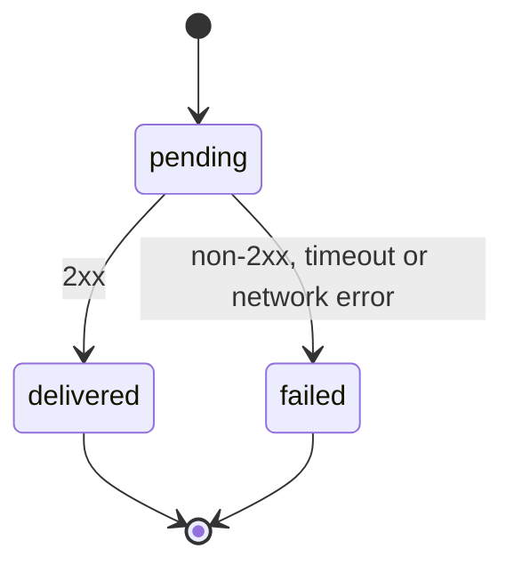

# F-003: Contract

## Data structures

```ts
export type DeliveryStatus = "pending" | "delivered" | "failed";

export interface Delivery {
  id: string;
  eventId: string;
  endpointId: string;
  status: DeliveryStatus;
  payload: string;
  claimedBy: string | null;
  claimedUntil: Date | null;
  responseStatus: number | null;
  lastError: string | null;
}
```

## Public signatures

```ts
export function ingestEvent(db: Db, input: { type: string; payload: unknown }): Result<{ eventId: string }, InvalidEvent>;

export function leaseDue(db: Db, workerId: string, now: Date): Delivery[];

export function deliver(db: Db, delivery: Delivery, endpoint: Endpoint, now: Date): Promise<void>;
```

## Errors

```ts
export interface InvalidEvent {
  kind: "InvalidEvent";
  field: "type" | "payload";
  reason: string;
}
```

## State transitions


