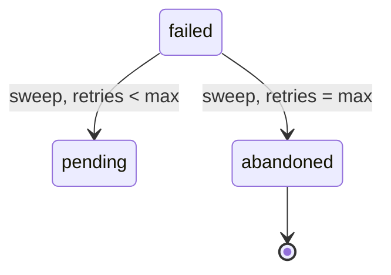

# F-004: Contract

## Data structures

```ts
export interface SweepConfig {
  intervalMs: number; // default 30_000
  maxRetries: number; // default 5, must be >= 1
}
```

## Public signatures

```ts
export function sweepFailed(db: Db, config: SweepConfig, now: Date): { requeued: number; abandoned: number };

export function startSweep(db: Db, config: SweepConfig): () => void;
```

## Errors

```ts
export interface InvalidSweepConfig {
  kind: "InvalidSweepConfig";
  field: keyof SweepConfig;
  reason: string;
}
```

## State transitions


