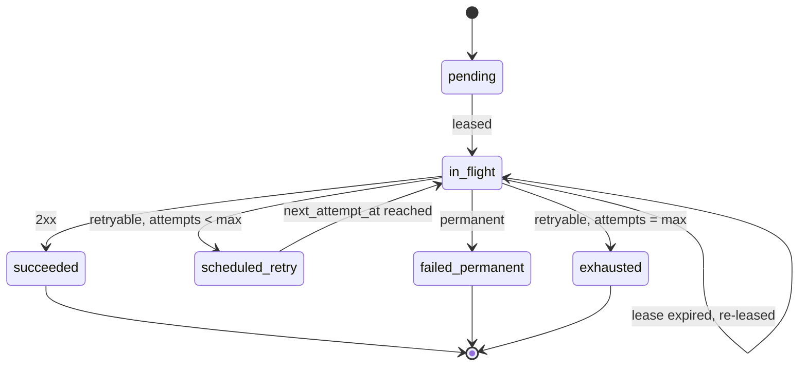

# F-005: Contract

## Data structures

```ts
export type DeliveryState =
  | "pending" | "in_flight" | "scheduled_retry"
  | "succeeded" | "failed_permanent" | "exhausted";

export interface RetryPolicy {
  baseDelayMs: number;  // default 2_000
  factor: number;       // default 2
  maxDelayMs: number;   // default 3_600_000
  maxAttempts: number;  // default 8, must be >= 1
}

export type RetryDecision =
  | { kind: "retry"; at: Date; attempt: number }
  | { kind: "permanent"; reason: string }
  | { kind: "exhausted"; attempts: number };
```

## Public signatures

```ts
export function classifyResponse(status: number, headers: Headers): "retryable" | "permanent";

export function computeDelay(
  policy: RetryPolicy, attempt: number, retryAfterMs: number | null, rand: () => number,
): number;

export function decideRetry(
  policy: RetryPolicy, attempt: number, result: AttemptResult, now: Date, rand?: () => number,
): RetryDecision;

export function parseRetryPolicy(raw: unknown): Result<RetryPolicy, InvalidRetryPolicy>;
```

## Errors

```ts
export interface InvalidRetryPolicy {
  kind: "InvalidRetryPolicy";
  field: keyof RetryPolicy;
  reason: string;
}
```

## State transitions


